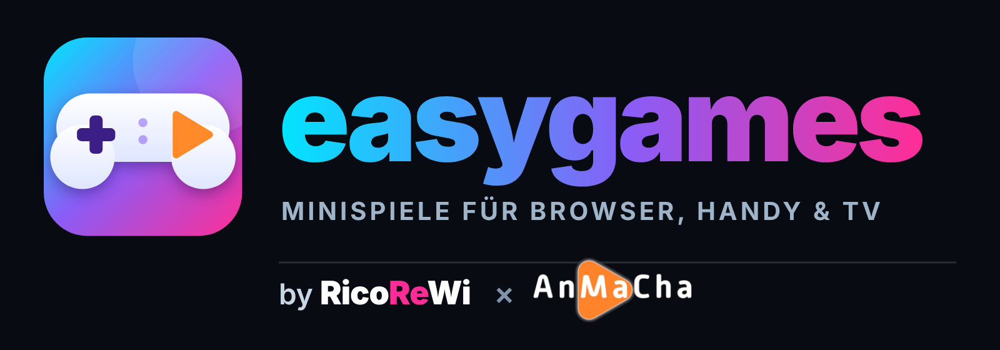

<p align="center"></p>

# easygames

Minispiele für Browser und Handy – jedes Spiel in einem eigenen Verzeichnis.
Spieleliste (GitHub Pages): https://ricorewioriginal-collab.github.io/easygames/

| Spiel | Verzeichnis |
|---|---|
| RicoLife 3D – Dein Leben. Deine Regeln. – 3D-Lebenssimulation: eigener Haushalt im Figureneditor, Bedürfnisse und Emotionen, begehbare Häuser bauen und einrichten (2 Etagen, Rückgängig), 9 Berufe, Schule, Beziehungen, Familie, Haustiere, 3 Geschichten, Jahreszeiten, Online-Besuche mit bis zu 3 Freunden, offline spielbar als PWA, optionaler Google-Spielstand (TypeScript, Three.js + Vite; Quelltext in [`ricolife-src/`](ricolife-src/), gebautes Ergebnis eingecheckt) | [`ricolife/`](ricolife/) |
| RicoRail Simulator 3D – Eisenbahnsimulator: 4 nachgebildete Strecken und 4 Fantasiewelten, 11 Führerstände, Fahrphysik, Signale/PZB als Spielmodell, Fahrplan, Güterverkehr, Rangieren, Stellwerk, 64 Szenarien, Karriere, Bahngesellschaft, Strecken-Editor, offline spielbar (TypeScript, Three.js + esbuild; Quelltext in [`ricorail/source/`](ricorail/source/)) | [`ricorail/`](ricorail/) |
| RicoVille – Deine Stadt lebt! – gemütliches 3D-Städtebauspiel: Straßen, Häuser, Einwohner, Felder, Produktionsketten, Läden, Miete, Aufträge per Bahn, Schiff und Flugzeug, Erweiterungen, über 80 Aufgaben, Modi Nostalgisch/Entspannt/Kreativ, offline spielbar als PWA, optionaler Google-Spielstand (TypeScript, Three.js + Vite; Quelltext in [`ricoville-src/`](ricoville-src/), gebautes Ergebnis eingecheckt) | [`ricoville/`](ricoville/) |
| RicoPoly 3D – Baue dein Imperium! Grundstücks-Brettspiel in 3D mit allen klassischen Regeln, drei Welten, 16 animierten Figuren, Computergegnern in drei Stufen, Spiel an einem Gerät und Online-Räumen per Code/Link (PeerJS, Gastgeber prüft alle Züge); Deutsch/Englisch, Google-Spielstand (Three.js, Klänge im Browser erzeugt) | [`ricopoly/`](ricopoly/) |
| Rico Flap 3D – Flatter-Klassiker in 3D: Rico im RicoReWi-Hoodie, 10 Level in 5 Welten, bewegliche Türme, Noten und Sterne, Endlos-Modus mit Rekord; Touch, Tastatur, Maus und Gamecontroller, Google-Spielstand (Three.js, Sounds im Browser erzeugt) | [`rico-flap/`](rico-flap/) |
| KIKO – Das Geheimnis der Sterneninseln – acht 3D-Level in vier Welten, Kristalle, Rätsel, Endgegner, Touch und Gamepad, lokaler Spielstand | [`kiko-sterneninseln/`](kiko-sterneninseln/) |
| Krawallvögel 3D – Schleuder-Physikspiel mit 150 Leveln in 10 Sender-Welten, 8 Vogelarten mit Fähigkeiten, 6 Schweinetypen, Glas/Holz/Stein/TNT, Endgegner König Grunz, Power-ups, goldene Sender-Kisten und Senderwand; Touch, Maus, Tastatur, Gamecontroller, Google-Spielstand, Offline-PWA (Three.js + planck.js, Sounds und Musik im Browser erzeugt; Tests: `node tools/test-krawallvoegel.cjs`) | [`krawallvoegel/`](krawallvoegel/) |
| Mahjong 3D – Jadepalast – Mahjong Solitaire in echtem 3D: Reise mit 48 Leveln in 8 Welten (bis zu 3 Sterne), 29 Layouts inkl. klassischer Schildkröte, Tagesrätsel mit Serie, Zeitjagd, Zen-Modus; immer lösbar gemischt, Tipp, unbegrenztes Rückgängig, Mischen, Kombos, 26 Erfolge, zwei Steinbild-Stile (auch ohne chinesische Schrift); Touch mit Zoom, Maus, Tastatur, Gamecontroller, Google-Spielstand, Offline-PWA (Three.js, nur bei Änderungen gerendert, Steinbilder und Klänge im Browser erzeugt; Tests: `node --test mahjong/tests/*.test.js`) | [`mahjong/`](mahjong/) |
| Pestwacht – Die letzte Zuflucht – Überlebens-, Aufbau- und 4X-Strategiespiel in 3D: ummauerte Stadt mit 34 Gebäudearten (bauen, verbessern, versetzen, abreißen, reparieren), Bewohner, Kranke und Seuche, 10 Rohstoffe, 3 Forschungsbäume, 12 Helden, 6 Truppenarten, Seuchenwellen mit 5 Feindarten und 3 Bossen, beobachtbare Schlachten, Weltkarte mit Kriegsnebel und Expeditionen, 8 Computer-Fraktionen mit Wirtschaft, Expansion, Diplomatie, Bündnissen und Kriegen untereinander (Utility-KI nach denselben Regeln wie der Spieler), Kampagne mit 5 Kapiteln und Freies Spiel, Ereignisse, Tages-/Wochenaufgaben, Erfolge, 3 Speicherplätze + Autosave, Export/Import, Offline-Fortschritt; Touch, Maus, Tastatur, Gamecontroller, Offline-PWA, Google-Spielstand (Three.js r128 lokal, Modelle und Klänge im Browser erzeugt; Tests: `node --test pestwacht/tests/*.test.js`, Browser: `node pestwacht/tests/smoke.cjs`) | [`pestwacht/`](pestwacht/) |
| Funkblasen – Bubble Shooter: 3D-Kugeln auf festem Sechseckgitter, 150 Level in 10 Welten, Endlosmodus, Tagesaufgabe, Freies Spiel, Spezialblasen (Bombe, Regenbogen, Blitz, Eis, Kette, Stern), Kristalle, Steine, Schalter, 30 Erfolge, Designs nur zur Optik, Maskottchen Funki; Touch, Maus, Tastatur, Gamecontroller, Google-Spielstand, Offline-PWA (Three.js, Sounds und Musik im Browser erzeugt; Tests: `node --test funkblasen/tests/*.test.js`) | [`funkblasen/`](funkblasen/) |
| ColorPop Universe – Die bunte Welt der knallenden Steine: SameGame-Knobelspiel mit 300 geprüften Leveln in 12 Welten, Spezialsteinen und Hindernissen, 14 Modi (Klassiker, Zen, Sprint, Zeitattacke, Zuglimit, Puzzle-Labor, Farbchaos, Gravitation+, Daily Pop, Wochenliga, Endlos-Turm, KI-Duell, Lokal zu zweit), 53 Erfolge, 38 Designs, prozeduraler Musik, Touch/Maus/Tastatur/Controller, Offline-PWA, Google-Spielstand | [`colorpop-universe/`](colorpop-universe/) |
| AnMaCha Radio Maze 3D – Arcade-Labyrinth-Klassiker in 3D mit Original-Regeln, 60 Level, Senderlogos als Bonus, Google-Spielstand, Offline-PWA (Three.js) | [`radio-maze/`](radio-maze/) |
| ZEITSPRUNG WISSEN – moderierte 3D-Wissensshow nach dem Zeitstrahl-Prinzip: 236 Ereignisse aus Geschichte, Politik, Erdkunde, Wissenschaft und Kultur (776 v. Chr. bis heute), 377 Wissensfragen, „Was war zuerst?“-Runden, 38 Bildrätsel, 16 historische Clips von Wikimedia Commons und 25 Songs zu Ereignissen über Deezer; A–D-Jahreswahl oder Zeitstrahl, TV-Handys per WR-Code/PIN, Google-Speicherung | [`zeitsprung-wissen/`](zeitsprung-wissen/) |
| ZEITSPRUNG CASTINGSHOW – moderierte 3D-Castingshow-Quizshow nach dem Zeitstrahl-Prinzip: 265 Show-Momente, 1247 Fragen zu DSDS (alle Sieger und Top 10), Das Supertalent, The Voice, Popstars, GNTM, Idol, X Factor und Got Talent, 31 YouTube-Videos, 44 Siegersongs über Deezer und 31 Bildrätsel; A–D-Jahreswahl oder Zeitstrahl, TV-Handys per WR-Code/PIN, Google-Speicherung | [`zeitsprung-castingshow/`](zeitsprung-castingshow/) |
| ZEITSPRUNG MOVIE – moderierte 3D-Filmshow mit 398 Fragen: 318 Quizfragen, 38 Filmmusik- und Serienintro-Hörfragen über Deezer/Spotify sowie 42 Bildrätsel; 12 eingebettete Trailer, A–D-Jahreswahl oder Zeitleiste, TV-Handys per WR-Code/PIN und Google-Speicherung | [`zeitsprung-movie/`](zeitsprung-movie/) |
| ZEITSPRUNG RADIO – moderierte 3D-Musikshow für TV, Smartphone und PC: 790 Quizfragen zu Charts, Jahrescharts, Künstlern, Songtiteln, Biografien, gemeinfreien Songtexten, ESC, DSDS, Popstars und The Voice; Musikrunden mit A–D-Jahreswahl oder Zeitleiste und Deezer/Spotify-Playern, WebRTC-Handys per WR-Code/PIN, Google-Speicherung und installierbare App. | [`zeitsprung-radio/`](zeitsprung-radio/) |
| ZOTIK – Die Splitter der Welten – neues 3D-Action-Rollenspiel mit 10 Kapiteln plus Endspiel, Begleitern, Rätseln, Zwischensequenzen, drei Enden, Casino, Halle der 100, Neuem Spiel+ und verwandelbarer Nautilux (Einzeldatei, Three.js; Quelle: Repo `ricorewioriginal-collab/zotik`, Ordner `zotik/`) | [`zotik/`](zotik/) |
| AnMaCha Radio Surfer – 3D-Endless-Runner (Three.js) | [`anmacha-radio-surfer/`](anmacha-radio-surfer/) |
| Royal Radio Match 3D – 3D-Match-3: 200 Level in 10 Radio-Welten, Spezialteile und Kombos, Funkhaus-Ausbau, Bonuslevel, Duell (lokal/KI) (Three.js, Sounds im Browser erzeugt) | [`anmacha-radio-match/`](anmacha-radio-match/) |
| AnMaCha Pinball – 3D-Flipper mit 13 Tischen (Three.js) | [`anmacha-flipper/`](anmacha-flipper/) (Ordnername bleibt) |
| AnMaCha Beat Surfer – 3D-Rhythmusspiel (Three.js, Musik wird im Browser erzeugt) | [`anmacha-beat-surfer/`](anmacha-beat-surfer/) |
| SHOW ME YOUR VOICE – Castingshow-Spiel zur TikTok-Show von RicoReWi: Avatar, Casting mit Jury-Gespräch, Zugabe und Goldenem Ticket, Gruppen-Recall, Mottoshow, Battle, Halbfinale und Finale; eigene Jury mit offenen Kriterien, Community-Voting mit Zitterbank, Backstage-Ereignisse, Training, Winterglanz-Gala, Show-Archiv (YouTube). Noten live aus den laut.fm-Sendern der RicoReWi-Familie (Quelle wird angezeigt), sonst eigene Beats | [`show-me-your-voice/`](show-me-your-voice/) |
| PRISMRUSH – hypnotisches 3D-Rhythmusspiel: 32 Level in 4 Welten, 13 Modi (Kampagne, Endlos, Tagesrhythmus, Sprint 90, Remix, Zen, Präzision, Spiegelwelt, Turbo, Blindflug, Gleitflug, Wandlauf, Tutorial), Combos, Overdrive, 19 freischaltbare Effekte, installierbar als PWA (TypeScript, Three.js + Vite, Musik und Sounds im Browser erzeugt; Quelltext in [`prismrush-src/`](prismrush-src/), gebautes Ergebnis eingecheckt) | [`prismrush/`](prismrush/) |
| AnMaCha Memory – modernes Memory mit den Sender-Logos (reines HTML/CSS, ohne Bibliothek) | [`anmacha-memory/`](anmacha-memory/) |
| AnMaCha Quest RPG – modernes 3D-Rollenspiel (Three.js + Vite; Quelltext in [`anmacha-quest-rpg-src/`](anmacha-quest-rpg-src/), gebautes Ergebnis eingecheckt) | [`anmacha-quest-rpg/`](anmacha-quest-rpg/) |
| AnMaCha Snake 3D – Snake mit Sender-Logos als Futter (Three.js, Sounds werden im Browser erzeugt) | [`anmacha-snake/`](anmacha-snake/) |
| AnMaCha Tower Defense – Cinematic-3D-Tower-Defense mit Sender-Logo-Türmen: Nachtstadt, Bloom, Schatten, Kamerafahrt, 8 modellierte Turm-Arten, 25 Wellen, 3 Karten (Three.js + Vite; Quelltext in [`anmacha-tower-defense-src/`](anmacha-tower-defense-src/), gebautes Ergebnis eingecheckt; Sounds & Musik im Browser erzeugt) | [`anmacha-tower-defense/`](anmacha-tower-defense/) |
| Machst du mich an? – Das Quiz! – TV-Quizshow im 3D-Studio (Three.js, Sounds werden im Browser erzeugt) | [`anmacha-quiz/`](anmacha-quiz/) |
| AnMaCha Koffer DEALER – Dealer-Show mit 13 Flightcases (Three.js, Sounds werden im Browser erzeugt) | [`anmacha-koffer-dealer/`](anmacha-koffer-dealer/) |
| AnMaCha Kart Rush – 3D-Arcade-Kartrennen, Splitscreen mit Handys als Lenkrad (Three.js, Sounds werden im Browser erzeugt) | [`anmacha-kart/`](anmacha-kart/) |
| AnMaCha Casino – 3D-Casino mit Spielgeld (€/$): 18 Spielautomaten (u. a. Gold Reels mit Sender-Logos, Expanding Wild im Tempel des Anubis, Walking Wilds in Star Fruits, Nugget-Feature mit bis zu 3 Feldern, Freispiele mit Upgrade, klebenden Wilds und Multiplikator, Bonusspiele mit Schatzwahl und Bonusrad, Buch-Freispiele, 243 Wege, Hold & Win mit Jackpots, Wild-Respin), wechselnde Glücks-Features mit Goldhammer, Nachdreh, Mystery-Jackpot, Kartenrisiko mit Farbe oder Symbol, Sonderspiel-Leiter, Roulette, Blackjack, Video-Poker, Glücksrad; Touch, Tastatur, Gamecontroller (Three.js, Sounds im Browser erzeugt; Tests: `node anmacha-gold-reels/tests/logic-tests.js`) | [`anmacha-gold-reels/`](anmacha-gold-reels/) (Ordnername bleibt) |
| AnMaCha Markthalle 24 – Supermarkt-Simulator (Draufsicht, Handy & PC), Preise, Personal, eigener Radiosender | [`anmacha-markthalle/`](anmacha-markthalle/) |
| Urwaldlager – die große Wildnis-Show in 3D: begehbares Dschungelcamp (Holz, Wasser, Feuer, Kochen, Schlafen), Mitcamper mit eigenem Tagesablauf und Beziehungen, 12 spielbare 3D-/2D-Prüfungen plus dreiteiliges Finale, transparent simuliertes Publikum, ganze Staffel mit Ausscheidungen, Speichern & Weiterspielen (Three.js lokal eingebunden, Sounds im Browser erzeugt, PC & Handy) | [`anmacha-urwaldlager/`](anmacha-urwaldlager/) |
| AnMaCha Gesucht & Gefunden – Ratestudio mit 4 Spielarten (Three.js, Sounds werden im Browser erzeugt) | [`anmacha-gesucht/`](anmacha-gesucht/) |
| Wortfunk – Das Wortlegespiel: Wörter legen wie im Kreuzworträtsel auf einem 15×15-Brett mit Bonusfeldern, fast 400.000 deutsche Wortformen (LanguageTool, CC BY-SA 4.0), Joker, Tauschen, +50 für alle 7 Steine; 2–4 Spieler gegen den Computer (3 Stufen, Leicht/Mittel mit bekannten Wörtern), an einem Gerät oder 🌐 online mit TV-Tisch und Handys (jedes Handy zeigt nur die eigenen Steine); Touch, Maus, Tastatur, Gamecontroller, Offline-PWA (reines HTML/CSS/JS, Wörterbuch als 470-KB-Wortgraph; Tests: `node --test wortfunk/tests/*.test.js`) | [`wortfunk/`](wortfunk/) |
| Wortgitter – Wörter wischen: benachbarte Buchstaben zu Wörtern verbinden, 4×4 Leicht, 5×5 Mittel, 6×6 Schwer, Zeitlimit oder Zen, Tagesgitter, Auswertung mit allen verpassten Wörtern; 🌐 online mit TV und Handys im selben Gitter (doppelt gefundene Wörter zählen nicht, Computer-Mitspieler); Touch, Maus, Tastatur, Gamecontroller, Offline-PWA (reines HTML/CSS/JS, nutzt das Wörterbuch von Wortfunk; Tests: `node --test wortgitter/tests/*.test.js`) | [`wortgitter/`](wortgitter/) |
| AnMaCha Solitaire – Patience (1/3 ziehen, nur lösbare Partien aus einer geprüften Liste), Spider (1/2/4 Farben) und FreeCell mit AnMaCha-Karten (Logo auf Rückseiten, Bildkarten und Pik-Ass): ziehen oder antippen, unbegrenzt rückgängig, Tipps, sicheres Auto-Ablegen, automatisch fertig, Tagesspiel, Statistik, Linkshänder-Modus, Cloud-Spielstand; Touch, Maus, Tastatur, Gamecontroller, Offline-PWA (reines HTML/CSS/JS; Tests: `node --test anmacha-solitaire/tests/*.test.js`, lösbare Partien: `node tools/anmacha-solitaire/mkseeds.js`) | [`anmacha-solitaire/`](anmacha-solitaire/) |
| Saftblitz – Schneide, was fliegt! Frucht-Schneidespiel (Canvas 2D, eigene Fruchtgrafiken): Klassik (3 Leben, Bomben, Herzfrüchte), Arcade (60 s, Power-Früchte Frost/Rausch/Doppelt, kritische Treffer, Gold-Kokosnuss mit AnMaCha-Logo), Zen, Radio-Rhythmus (im Browser erzeugter Beat, Schnitte im Takt) und 2 Spieler mit geteiltem Bildschirm; Combos, 6 Klingen, 4 Schauplätze, 18 Erfolge; Touch, Maus, Tastatur, Gamecontroller (eigene Stick-Steuerung, Menüs über gamepad.js), Offline-PWA (Tests: `node --test saftblitz/tests/*.test.js`) | [`saftblitz/`](saftblitz/) |
| Funkmaler – Malen & Raten: Partyspiel für 2–8, Fernseher/PC zeigt QR-Code, Zeichnung live, Hinweise und Punkte; Maler malt auf dem Handy (Farben, Stiftgrößen, Radierer, Rückgängig), alle anderen raten auf ihrem Handy (knapp-daneben-Hinweis nur privat); Beitreten per `?join=CODE`, TV-Link `?tv`, Verbindung über `cloud/fire-peer.js`, Handys verbinden sich nach Aussetzern selbst wieder; rund 480 Begriffe in 3 Stufen, Galerie, Modus „Ein Gerät“ (reines HTML/CSS/JS; Tests: `node --test funkmaler/tests/*.test.js`, Browser-Test mit TV + 3 Handys: `funkmaler/tests/e2e.mjs`) | [`funkmaler/`](funkmaler/) |
| Winzflitzer 3D – Rennen auf dem Küchentisch: Micro-Rennspiel (Three.js) mit 24 Strecken in 8 Welten (Frühstückstisch, Schreibtisch, Badewanne, Garten, Sandkasten, Billardtisch, Werkbank, Kinderzimmer) und 8 Fahrzeugarten (Sportflitzer, Formel, Speedboot, Hubschrauber, Geländewagen, Kugelflitzer, Panzer mit Schüssen, Monstertruck); Meisterschaft (24 Rennen, Leben, Ausscheiden, Bonusrunden), Kopf-an-Kopf-Turnier (Lichter-Duell, wer aus dem Bild fällt, verliert), Mehrspieler 2–4 an einem Gerät, Einzelrennen, Zeitfahren mit Geist; Rampen, Brücken, Lücken, Turbo-Streifen, rutschige und klebrige Flecken; Touch, Tastatur (2 Spieler), Gamecontroller | [`winzflitzer/`](winzflitzer/) |
| Funk-Minigolf 3D – Die Radioportal-Tour: 18 Bahnen (Three.js) quer durch das RicoReWi × AnMaCha Radioportal mit Senderlogos, Sendeplan, Voting, Sleep-Timer und Funkturm; echte Minigolf-Hindernisse (Looping, Windmühle, Vulkan, Doppelwelle, Tor, Netz, Blitz, Plattenteller) plus Sand, Eis, Wasser und Portale; Radio mit Senderwahl (Live-Stream läuft das ganze Spiel); 1–4 Spieler an einem Gerät, Scorekarte, Rangliste; Touch, Maus, Tastatur, Gamecontroller | [`funkgolf/`](funkgolf/) |
| Tortenschlacht – Sahne für alle! Wurfspiel im Moorhuhn-Stil (Canvas 2D, eigene Cartoon-Figuren): Torte, Sahnespritze, Kirschbombe; Konditor wirft zurück; Solo mit scrollender Landschaft und Rangliste, bis zu 4 an einem Bildschirm (Maus, Tastatur, Controller) oder 🌐 online mit dem Handy als Zielgerät (TV-Link `?tv`); Radio mit Senderwahl | [`tortenschlacht/`](tortenschlacht/) |
| Funkgalgen – Rette den Moderator! Modernes Galgenmännchen in 3D (Three.js): Moderator auf einem Lautsprecher-Turm über einer Riesen-Torte; Solo-Serie mit 9 Kategorien oder Wortfunk-Wörterbuch, Tageswort zum Teilen, Duell an einem Gerät, 🌐 online (Handys raten um die Wette, TV-Link `?tv`); Tastatur, Touch, Controller, Radio | [`funkgalgen/`](funkgalgen/) |
| Frequenz-Minen 3D – Finde die Störsender! Modernes Minesweeper in 3D (Three.js) auf der Radarscheibe: Leicht/Mittel/Schwer, Tagesrätsel zum Teilen, Peiler, Peilung (Hinweis), Zahl antippen, Zoom; Ladebildschirm, Game-over-Auswertung, Rekorde, Rangliste; Maus, Touch, Tastatur, Controller, Radio | [`frequenzminen/`](frequenzminen/) |
| Sendemast-Sumo – Schubs sie vom Mast! Party-Prügelei in 3D (Three.js, Toon-Look) mit Sumo-Ringern auf einer bröckelnden Plattform über den Wolken: Schubs, Stampfer, Power-ups, 5 Arenen (Wind, Blitze, Eis, Kippen), Turnier gegen KI, schnelles Spiel, lokal zu viert (Tastatur + bis zu 4 Controller), 🌐 online mit Handys als Controller (TV-Link `?tv`); Konsolen-Menü, Ladebildschirm, Ergebnis-Podium, Rangliste | [`sendemast-sumo/`](sendemast-sumo/) |
| Wolkenhopser – Hopsi will nach oben! Endlos-Springspiel (Canvas 2D, eigene Figuren): Plattformarten, Federn, Trampoline, Propellermütze, Raketenrucksack, Schutzblase, Monster, schwarze Löcher, 5 Gebiete, 8 Hopsis zum Freischalten, Tagesrekord, 🌐 Online-Rennen (alle in derselben Welt); Ladebildschirm, Konsolen-Menü, Game over, Rangliste; Touch (Hälften oder Neigen), Tastatur, Controller | [`wolkenhopser/`](wolkenhopser/) |
| 2048 Deluxe – Die Zahlen-Show mit Rico: 2048 in 3D (Three.js, Toon-Look) mit Moderator Rico als Comic-Figur, der auf Züge reagiert; Klassisch 3×3–6×6 (speichert automatisch), Blitz (3 Min.), Tages-2048 zum Teilen, Zen, Antippen (zwei gleiche Zahlen antippen); Rückgängig- und Hammer-Joker; Ladebildschirm, Konsolen-Menü, Sieg- und Game-over-Bildschirm, Rekorde, Rangliste; Wischen, Tastatur, Controller | [`deluxe-2048/`](deluxe-2048/) |
| Hüpfstraße – Hüpf so weit du kannst! Endlos-Hüpfspiel im Klötzchen-Look (Three.js, eigene Figuren): Straßen, Flüsse mit Stämmen/Seerosen, Gleise mit Zug-Warnung, Funk-Drohne, Münzen, 13 Figuren (u. a. Rico, Waldläuferin mit Hund), 5 Gebiete, Tagesstrecke zum Teilen; Ladebildschirm, Konsolen-Menü, Figuren-Laden, Game over, Rekorde, Rangliste; Tippen/Wischen, Tastatur, Controller | [`huepfstrasse/`](huepfstrasse/) |
| Werwolf-Nacht: Partyspiel im Scherenschnitt-Look (SVG) mit Werwölfen, Seherin, Hexe, Jäger und Leibwächter, Erzählerstimme (Browser: Männerstimme, App: Android-Stimme); Solo gegen Computer-Dorfbewohner mit Verdachts-Gedächtnis oder 🌐 Online & Handys (Fernseher = Dorf, Handys = geheime Rollen, Computer füllen auf 5–12 auf); Touch, Tastatur, Controller | [`werwolf-nacht/`](werwolf-nacht/) |
| FALL·AKTE – Das Krimi-Rätsel: Detektiv-Rätsel im Noir-Comic-Stil (SVG, kein WebGL); 6 Welten × 3 Fälle, Tagesfall, Zufallsfälle; eindeutig lösbare Fälle aus Startzahlen, Tatorte mit Lupe, Labor (Fußspur, Fingerabdruck, Code-Rad, zerrissener Brief), Verhöre mit Fragenbudget, Notizbuch, Anklage mit Beweisführung, Rang & Rangliste; Touch, Tastatur, Controller | [`fall-akte/`](fall-akte/) |
| Bowling-Bahn 3D: Bowling (Three.js) mit eigener Kugel- und Kegelphysik (Öl/Hook, Kegel-Kettenreaktionen, Rinne), echte Zählweise mit Anzeigetafel; Einzelspiel (Rangliste), Gegen CPU (3 Stärken), Party mit 2–4 Spielern (auch CPU); alle 69 EASYCLASH-Helden als Bowler (Menschen als realistische, animierte Figur); Wischen, Tastatur, Controller | [`bowling-bahn/`](bowling-bahn/) |
| Oma-Rennen – Raketen-Rollatoren: 3D-Funracer (Three.js) mit der Rennsimulation von Kart Rush (`anmacha-kart/sim.js`, `track.js`): 7 Omas und ein Opa mit eigenen Fahrwerten (4 freischaltbar), 6 Stadt-Strecken mit Streckentücken (Tauben, Rolltreppen-Abkürzungen, Möwen, Brücken, Gespenster), Oma-Gegenstände (Gebiss, Handtasche, Pralinen-Rakete, Regenschirm …), Drift-Turbo, Windschatten; Grand Prix (3 Cups, Punkte, Siegerehrung), Einzelrennen, Zeitfahren (Bestzeiten), Zu zweit (geteilter Bildschirm), 🌐 Online & Handys (Fernseher + bis zu 4 Handys als Lenkrad, Computer-Omas füllen auf); Oma-Sprüche mit Stimme (Browser: Frauenstimme, App: Android-Stimme); Touch, Tastatur, Controller | [`oma-rennen/`](oma-rennen/) |
| Küchen-Chaos – Kochen im Team: Koch-Teamspiel (Three.js) mit Raster-Küche, Schneiden, Kochen (Topf/Pfanne), Anbrennen und Feuer, Spülen, Förderband und Eis-Boden; 6 Küchen mit Sternen; Computer-Köche planen selbst (holen, schneiden, kochen, anrichten, servieren, löschen, spülen); Solo mit Computer-Koch oder Wechseln zwischen zwei Köchen, 🌐 Online & Handys (Fernseher + bis zu 4 Köche: Handys, Controller, Tastatur, Computer füllen auf); Touch wie Kart Rush, Tastatur, Controller | [`kuechen-chaos/`](kuechen-chaos/) |
| Brainrot Parkour – Obby Assurdo: 3D-Obby (Three.js) mit 18 eigenen Brainrot-Figuren (prozedural, PBR/Klarlack, Umgebungsspiegelung, Canvas-Texturen; `js/chars.js`), italienischer Sprachausgabe (`js/voice.js`, Männer-/Frauen-/Figurenstimme, viele Ereignis- und Zufallsrufe) und Untertiteln; Streckenbau mit 12 Segmenttypen (Lücken, Soße, Schiebe-/Fall-Plattformen, Drehbalken, Polster, Eis, Förderband, Säulen …), 3 Welten × 10 Abschnitte, Bambini/Normale/Esperto, Computer-Läufer mit echter Physik (jede Strecke im Test machbar); Minigames Rennen, Pavimento Lava (3 Etagen), Torre Infinita, „Chi lo dice?“; 🌐 Online-Rennen (bis 8 Geräte, Mitspieler als Geister); automatische Grafikqualität; Tastatur/Maus, Touch (Joystick + Kamera-Wischen), Gamepad | [`brainrot-parkour/`](brainrot-parkour/) |
| Die große Challenge-Show: 3D-Spielshow (Three.js) im TV-Studio mit Tribünen-Publikum (InstancedMesh), Lichtgerüst und Show-Bildschirmen; bis zu 24 Bohnen-Kandidaten mit Nummer und Hut, sechs Runden (`js/core.js`, in Node testbar): Ampel-Lauf mit Ampel-Roboter, Wackelbrücke, Seilziehen im Takt, Keks-Kunst (Form nachfahren), Reise nach Jerusalem, Schubs-Finale; Computer-Kandidaten in 3 Stärken, deutscher Moderator (`js/voice.js`) mit Untertiteln, Konfetti statt Gewalt; 🌐 Online & Handys: Gastgeber rechnet die Show, Gäste senden Eingaben und sehen einen Spiegel der Show oder sind im Fernseher-Modus (`?tv`) nur Controller, Jubel-Emojis; Tastatur/Maus, Touch, Gamepad | [`challenge-show/`](challenge-show/) |
| Groove Arena – Tanz mit!: Tanzspiel mit YouTube (offizielle IFrame-API, youtube-nocookie); Songsuche ohne API-Schlüssel über iTunes, Videos über Piped/Invidious (mehrere Server, der schnellste gewinnt), Songaufbau aus lrclib-Zeitstempeln; `js/core.js` (in Node testbar): Skelett mit Vorwärtskinematik, Arm-Muster × Schritte × Signatur-Moves je Stil, Choreograf je Song (ganze Länge, Refrain-Wiederholung, Gold-Moves), Posenvergleich, Handy-Bewegung, Rhythmus, Takt-Erkennung (Mikrofon-Onsets, Mitklopfen); Kamera mit MediaPipe Pose lite aus `vendor/mediapipe-pose/` (lokal, kein Upload); echte 3D-Tänzer aus `figuren/` (Rico, Zotik u. a.) + Charakter-Editor, Piktogramme, Song-eigene Moves je Song und Modus; 📻 Radio: laut.fm-Streams der RicoReWi-Sender (Takt aus dem Stream per CORS-Analyse, Titelwechsel über `current_song` → neue Choreo); 👀 Nur tanzen ohne Wertung; Quellenangabe (YouTube-Kanal + Link, laut.fm, iTunes, LRCLIB) überall; 🌐 Online & Handys: Gastgeber schickt Song/Takt/Zeit, jedes Gerät bewertet selbst | [`groove-arena/`](groove-arena/) |
| Stadt Land Plus – Stadt, Land und dein Thema: Stadt-Land-Fluss (Three.js-Buchstabentrommel, 3D-Globus) mit frei wählbarem dritten Thema (14 Wortlisten oder eigene Kategorie) und bis zu 3 Extra-Spalten; Wissensdatenbank `js/db/` (250 Länder aus world-countries, 33.500 Städte aus all-the-cities + alle deutschen Gemeinden, ~330 Flüsse, Wortlisten; Generator `stadt-land-plus/tools/build-db.cjs`), schlaue Prüfung (Umlaute, Artikel, weibliche Formen, Mehrzahl, Tippfehler inkl. Vertauschung, zusammengesetzte Wörter), Infos mit Globus, Nachschlagen; Prüfung automatisch/Abstimmung/Moderator; STOPP-Taste, Punkte 20/10/5; Solo gegen bis zu 5 Computer in 3 Stärken; 🌐 Online & Handys (Fernseher + bis zu 12 Handys, Moderator am Fernseher oder Handy); Tastatur, Touch, Controller mit Bildschirmtastatur | [`stadt-land-plus/`](stadt-land-plus/) |
| Konfetti-Party – Knallbonbons in der Arena: Arena-Partyspiel (Three.js) im Stil klassischer Bomben-Arenen, aber mit Knallbonbons und Konfetti: Kartons, Extras (Bonbons, Reichweite, Rollschuhe, Kick, Schild, Fernzünder, Wirrwarr), Kettenreaktionen, schließende Arena; 5 Arenen, Turnier mit Pokalen, Schnelle Party; Computer-Gäste in 3 Stärken (Gefahrenkarte, Fluchtwege, Kartons, Extras, Jagd); 🌐 Online & Handys (Fernseher + bis zu 4 Gäste: Handys, Controller, Tastatur, Computer füllen auf); Touch wie Kart Rush, Tastatur, Controller | [`konfetti-party/`](konfetti-party/) |
| Darts-Arena 3D – Game On in der Neon-Kneipe: Steeldarts (Three.js) an einem Board nach Turniermaß mit Drahtspinne, Zielen per Ziehen und Wurf per Wisch (Tempo = Höhe, Richtung = Seite, zitternde Hand), Kraftbalken für Tastatur/Controller; 501/301/701 (Double-/Master-/Single-Out, Double-In, Legs, Checkout-Hilfe), Cricket (Standard, Cut-Throat, ohne Punkte), Elimination, Around the Clock, Shanghai, Killer, Halve-It, Bob’s 27, Count-Up (Rangliste), Training; 1–4 Spieler, Computer in 3 Stärken, Caller per Sprachausgabe, Rekorde; Touch, Tastatur, Controller | [`darts-arena/`](darts-arena/) |
| Funk-Billard 3D: 8-Ball-Pool (Three.js) mit eigener Kugelphysik (Banden, Taschen, Effet) in einer Neon-Funk-Lounge; Ziellinie mit Geisterkugel, Kraftbalken, Ball in der Hand, Foulregeln; Gegen CPU (3 Stärken, Rangliste), Zu zweit, 🌐 Online (zwei Geräte per Code/QR), Training; Touch, Tastatur, Controller | [`funk-billard/`](funk-billard/) |
| EASYCLASH – Das Turnier aller Helden: 3D-Prügelspiel (Three.js, Toon-Look) mit 69 Figuren aus 18 easygames; 4 Knöpfe (Fäuste/Füße) mit Befehlsliste, Trefferstopp, Ketten, Seitschritt, hoch/mittel/tief, Würfe, Luft-Kombos, Spezial je Figur, Wut & Finale; Arcade (Rangliste), Versus, Gegen CPU, Training, 🌐 Online & Handys als Controller; 6 Arenen; Tastatur (2 Spieler), Controller, Touch | [`easyclash/`](easyclash/) |
| AnMaCha Frequenzrad – Buchstaben-Rätsel mit Glücksrad, bis zu 4 Spieler + Computer, Handy-Kopplung (reines HTML/CSS/JS, Sounds im Browser erzeugt, 150 Rätsel) | [`anmacha-frequenzrad/`](anmacha-frequenzrad/) |
| AnMaCha Preisradar – Preis-Schätzspiel mit 5 Spielarten, bis zu 4 Spieler + Computer, Handy-Kopplung (reines HTML/CSS/JS, Sounds im Browser erzeugt, 208 Produkte) | [`anmacha-preisradar/`](anmacha-preisradar/) |
| AnMaCha Funkparcours – 3D-Hindernis-Zeitspiel (Einzelläufe, Zeiten werden verglichen), 3 Parcours, Geist, bis zu 4 Läufer, Handys als Pads (Three.js, Sounds im Browser erzeugt) | [`anmacha-funkparcours/`](anmacha-funkparcours/) |
| Funkhaus Reality – Live-WG-Simulation im Radiostudio (3D-Haus, Allianzen, Nominierung, Hörervotum, bis zu 4 Menschen mit Handy-Pads + KI-Mitbewohner) | [`FunkhausReality/`](FunkhausReality/) |
| Mach mich aus! – Funk-Dating-Show mit 20 Pulten und Lampen (3D-Studio, Kandidat oder Pult, Quiz, Talent, Joker, bis zu 4 Menschen mit Handy-Pads) | [`MachMichAus/`](MachMichAus/) |
| FABELKICK 3D – Fantasy-Fußball wie bei den großen Konsolenspielen: 8 Fabel-Teams (Affen, Gorillas, Orks, Elfen, Zwerge, Trolle, Drachenbrut, Yetis) spielen 11 gegen 11, Pässe, Steilpässe, Flanken, Kopfbälle, Grätschen, Fouls, Freistöße mit Mauer, Ecken, Elfmeter, eine Spezialkraft pro Team, Gegner-KI in 4 Stufen, Fabel-Pokal, Elfmeterschießen, Training, 3 Arenen, Ladescreen und Konsolen-Hauptmenü; Touch, Tastatur und bis zu 4 Gamecontroller (auch zu zweit), Google-Spielstand, Offline-PWA (Three.js r128 lokal, Figuren und Klänge im Browser erzeugt) | [`fabelkick/`](fabelkick/) |
| TURBOKICK – 3D-Auto-Fußball mit Nitro (Bots, Splitscreen, online per QR-Code/Text-Code ohne Server; TypeScript/Three.js, eigene Physik) | [`turbokick/`](turbokick/) |
| RIFTZONE – 3D-Battle-Royale: Riftfähre, Gleiter, 14 Orte, 8 Waffen, Bauen oder ohne Bauen, Fahrzeuge, Sturm in 7 Phasen; Solo/Duo/Squad offline gegen bis zu 99 Bots oder online ohne Server (ein Gerät eröffnet einen Raum, Freunde treten per Code bei, Vermittlung über Firebase) bzw. mit eigenem Server (Gruppen, öffentliche und private Lobbys). TypeScript, Three.js, WebSocket/WebRTC; Quelltext und Server in [`riftzone/`](riftzone/), gebautes Spiel in `riftzone/app/` | [`riftzone/`](riftzone/) |
| PARTYVERSE – 3D-Brett-Partyspiel mit 50 Brettern in 5 Welten, 22 Minispielen, 8 Figuren; gegen Bots, lokal oder 🌐 online mit Freunden per Raumcode/Link/QR über Firebase (TypeScript/Three.js) | [`partyverse/`](partyverse/) |
| AnMaCha Hörerwahl – das große Umfrage-Duell (reines HTML/CSS/JS, Sounds werden im Browser erzeugt, 120 Fragen) | [`anmacha-hoererwahl/`](anmacha-hoererwahl/) |
| AnMaCha Showdown – Mikro-Duell mit 8 Mini-Spielen (Three.js, Sounds werden im Browser erzeugt) | [`anmacha-showdown/`](anmacha-showdown/) |
| AnMaCha Spielesammlung 3D – Rausschmeißer (Laufspiel), Würfelfieber (5-Würfel-Spiel), Schach, Leiterspiel, Vier in einer Reihe, Dame, Mühle (Three.js, Sounds werden im Browser erzeugt) | [`anmacha-spielesammlung/`](anmacha-spielesammlung/) |
| Gay Life! – queere Lebenssimulation mit Humor (wird zu „GayLife – Ein Leben in allen Farben“ ausgebaut, siehe [`gay-life/PLAN.md`](gay-life/PLAN.md) und [`gay-life/FORTSCHRITT.md`](gay-life/FORTSCHRITT.md)): Alltag mit Uhrzeit und Bedürfnissen, eigene betretbare Wohnung, Euro-Konto, Barkeeper-Job, Späti, Handy mit Karte und Kontakten; begehbare 3D-Stadt (Three.js) mit Aufträgen, Nebenaufträgen und vierzehn Minispielen (u. a. Date-Roulette, Clubnacht-Schicht, Regenbogen-Rave, Tanzbattle, Karaoke, Sauna-Aufguss, Dunkelkammer, Casting-Tag, Klischee-Quiz), Kleiderschrank zum Freischalten, Mehrspieler per Code/QR (gemeinsam durch die Stadt, Emotes, Duelle), Cloud-Speicher | [`gay-life/`](gay-life/) |
| AnMaCha Kartenrausch 3D – 6 Kartenspiele mit wählbaren 3D-Figuren und Anleitung im Spiel: Stapelrausch (Zahlentürme 1–12, Zielstapel leeren), Farbflash (Farbe oder Zeichen bedienen), Phasenjagd (10 Phasen), Mau-Mau, Schwimmen (31) und Kartendomino; gegen Computer, lokal, online per Code/QR oder als TV-Tisch mit Handys (jedes Handy zeigt nur die eigenen Karten) (Three.js, PeerJS, Sounds werden im Browser erzeugt) | [`anmacha-kartenrausch/`](anmacha-kartenrausch/) |
| KLOTZFUNK 3D – Voxel-Sandbox: prozedurale Welt, Abbauen/Setzen, Hotbar, Inventar, Radio-Logo-Blöcke, Spezial-Blöcke (Feder, Turbo, Aufwind, Radio-Beats, Regenbogen, Neon), Seilhaken, Gleiten, Minikarte, Tag/Nacht, 3 Speicherplätze, Touch-Steuerung (Three.js + Vite; Quelltext in [`anmacha-klotzfunk-src/`](anmacha-klotzfunk-src/), gebautes Ergebnis eingecheckt) | [`anmacha-klotzfunk/`](anmacha-klotzfunk/) |
| Bunte Insel – Kinderspiel mit offener Welt: laufen, 10 Fahrzeuge inkl. Hubschrauber, Boot & Zug-Simulation, Piratenschiff, Schießbude (nur Attrappen), Mitspielen per Code/QR, 11 Mini-Spiele, 3 Spielstände, Kinder-Extras (Fotos, Musik, Malen), Garten, Bauernhof, Freibad, Vorlesen, Spielzeugladen, Bauen wie bei den Sims, Spaß-Aktionen (Three.js, Touch mit festem Joystick & Tastatur, Sounds werden im Browser erzeugt) | [`bunte-insel/`](bunte-insel/) |
| Spinwelten 3D – Insel-Abenteuer mit Runenmaschine: 30 schwebende 3D-Inseln aufbauen, Stürme und Schatzexpeditionen gegen 16 Computer-Inseln, 240 Karten, 12 Begleiter, 8 Minispiele, Story mit 60 Aufgaben; 🌐 online in privaten Räumen per Code/QR (Three.js r128, PeerJS über Firebase, kein Echtgeld). Optionaler Server für Online-Konto, Ranglisten und Teams: [`spinwelten-backend/`](spinwelten-backend/) | [`spinwelten/`](spinwelten/) |

## Als App installieren (PWA)

Jedes Spiel lässt sich zusätzlich zur Einbindung über seinen **Direktlink** auf dem Handy als App installieren (Chrome/Android: Hinweis „📲 Als App installieren“ oder Menü ▸ „App installieren“; iPhone: Teilen ▸ „Zum Home-Bildschirm“). Die App startet im Vollbild, läuft nach dem ersten Spielen auch offline und **aktualisiert sich automatisch** (Service Worker: Netz zuerst, bei Ausfall der Cache). Erzeugt von `tools/make-pwa.py` (siehe „Neues Spiel hinzufügen“); PRISMRUSH und Wobbel bringen eine eigene PWA mit.

## Einbinden – alle Optionen im Überblick

Ausführlich mit Generator: [`einbinden.html`](https://ricorewioriginal-collab.github.io/easygames/einbinden.html).

| Option | Wofür | Code |
|---|---|---|
| Direktlink | ein Spiel als ganze Seite (am robustesten) | `https://…/easygames/<spiel>/` |
| iframe / `easygames.js` | ein Spiel auf deiner Seite, Vollbild-Knopf | `<div data-easygames="snake">` |
| **Spiele-Hub** (neu) | eigene Spieleseite in deinem Design, ohne iframe, mit Echtzeit | `<div data-anmacha-hub>` + `hub/anmacha-hub.js` |
| **Login & Konto** (neu) | Google-Login im Kopf deiner Seite, gekoppelt mit allen Spielen | `AnMaChaAccount.mount('#konto')` |
| Ranglisten, Erfolge, Konto, Profil, Chat | easygames-Seiten einbetten | `data-easygames="ranglisten"` u. a. |
| Bibliothek | die komplette easygames-Übersicht als iframe (sieht wie easygames aus) | `?embed=1` |

**Spiele-Hub:** `AnMaChaHub.mount('#ziel', { theme: { accent, accent2, card, text, muted, radius, line } })` – Farben/Schrift kommen von deiner Seite (`--egh-*`), Suche, Kategorien, Favoriten, „Weiterspielen“, Spiel des Tages. Neue Spiele erscheinen ohne Neuladen (Versionsprüfung alle 60 s); Favoriten gleichen sich mit dem Konto ab.

## Anmeldung & Konto (Kurzfassung)

- **Ein Google-Login für alles:** `cloud/anmacha-account.js` (Knopf + Menü), Token im Browser (`anmacha-rating-token`), gültig für Spielstände, Favoriten, Bewertungen und Kommentare.
- **Spielstände liegen auf dem eigenen Server** (`ricorewi-radio.de/cms/api.php`, `saves_*`), nicht mehr in Firestore. Fremde Seiten melden sich über das Fenster `ricorewi-radio.de/anmelden.html` an (nichts bei Google einzutragen), `easygames.js` reicht das Konto an alle eingebetteten Spiele weiter.
- **Firebase** bleibt für Google-Auth der Spiele, Ranglisten, Erfolge, Profil/Freunde, Chat, Online-Mehrspieler und die App-Kopplung. Details: [`cloud/README.md`](cloud/README.md) und die README von ricorewi-radio.
- Tests: `node tools/test-account.cjs`, `test-hub.cjs`, `test-cloud-calls.cjs`, `test-konto.cjs`.

## Online-Kopplung über Firebase

Alle Spiele mit Handy-Kopplung oder Online-Modus (Code/QR) verbinden sich über Firebase wie RicoPoly: `cloud/fire-peer.js` ersetzt `window.Peer` durch eine PeerJS-kompatible Klasse, Firebase vermittelt nur den Verbindungsaufbau, gespielt wird direkt zwischen den Geräten. Fällt Firebase aus, läuft alles automatisch über PeerJS weiter. Neue Spiele mit PeerJS binden `<script src="../cloud/fire-peer.js"></script>` vor ihrem Spielcode ein.

**Mehrspieler-Regel:** Einladungs-, Beitritts- und TV-Links zeigen immer auf die easygames-Homepage (`https://ricorewioriginal-collab.github.io/easygames/…`), nie auf die lokale App-Adresse – so funktionieren sie auf jeder Plattform. Umgesetzt in `cloud/fire-peer.js` (`EasyGamesLink.share()`), `device.js` und `gamekit.js`; alle Regeln stehen in [`CLAUDE.md`](CLAUDE.md#mehrspieler-regeln-fest-gelten-für-alle-spiele). Jedes Online-Spiel zeigt die Möglichkeit im Hauptmenü mit 🌐 „Online“. Details, Verbrauch und die einmalige Freischaltung in der Firebase-Konsole: [`cloud/README.md`](cloud/README.md#online-kopplung-aller-spiele-über-firebase-cloudfire-peerjs).

## Gamecontroller

Alle Spiele lassen sich mit einem Gamecontroller (Xbox, PlayStation, 8BitDo …, per USB oder Bluetooth) spielen.

- **Eigene Controller-Steuerung** haben KIKO, Rico Flap, Radio Maze, Kart Rush, Klotzfunk, Quest RPG, Bunte Insel 1 und 2, Pufi Farbwind, Riftzone, Taschi, Turbokick, FABELKICK, Funkparcours, Funkblasen und AnMaCha Casino.
- **Alle anderen Spiele** binden `gamepad.js` aus dem Hauptordner ein (`<script src="../gamepad.js" data-pad="…" defer></script>`). Die Datei übersetzt den Controller in das, was das Spiel schon kann:
  - Steuerkreuz und linker Stick = Pfeiltasten, **A** = Enter, **B** = Esc, **X** = Leertaste, **Y** = E, **LB/RB** = Q/E, **Start** = P, **Select** = M – pro Spiel angepasst im Attribut `data-pad` (z. B. `a=Space/Enter` = Leertaste, und nur wenn das Spiel sie nicht nutzt, Enter; `ls=wasd`; `y=-` = nichts).
  - In Menüs, die nicht auf Pfeiltasten reagieren, springt das Steuerkreuz von Knopf zu Knopf (gelber Rahmen), **A** drückt ihn.
  - **Rechter Stick** = Mauszeiger, **A** klickt (halten = ziehen), z. B. für Koffer, Spielbretter und Türme.
  - Ohne Controller läuft nichts mit. Spiele mit eigener Controller-Steuerung binden die Datei nicht ein, damit nichts doppelt reagiert.
- **Texteingaben** (z. B. Antworten in der Hörerwahl) gehen weiterhin nur über Tastatur oder die Handy-Pads.

Für EmulationStation siehe [unten](#emulationstation-es-de-retropie-batocera): das Startskript öffnet den Browser so, dass auch der Ton ohne Klick startet (Browser zählen Controller-Tasten nicht als „Nutzer-Klick“).

## Gemeinsame Figuren (figuren/)

Realistische, animierte 3D-Menschen für alle Spiele: zwei CC0-Grundkörper mit 22 Bewegungen, Kleidung, Hautton, Frisuren und Hüte entstehen zur Laufzeit.
Einbinden: `../vendor/three-r128-gltfloader.js` und `../figuren/figuren.js` laden, dann `EasyFiguren.create({ THREE, base: '../figuren/' }).make(look)`.
`fromRoster()` macht die Figuren aus `easyclash/js/roster.js` (69 Figuren aus 18 Spielen) überall spielbar. Details: [figuren/README.md](figuren/README.md). Genutzt von: Funkparcours, Bowling-Bahn 3D (menschliche Bowler).

## Spieleliste, Vollbild und Teilen

Die Seite zeigt alle Spiele als App-Kacheln. Ein Klick öffnet das Spiel in einem App-Fenster, oben gibt es
◀ ▶ (nächstes/voriges Spiel), **⛶ Vollbild** (echtes Browser-Vollbild; wo das nicht geht, z. B. iPhone, öffnet sich das Spiel als ganze Seite)
und **⤴ Teilen**. Dort stehen für jedes Spiel der **direkte Link** und der **iframe-Code** zum Kopieren (bzw. das Teilen-Menü des Handys).

- Direktlink zu einem Spiel: `https://ricorewioriginal-collab.github.io/easygames/anmacha-flipper/`
- Spieleliste mit sofort geöffnetem Spiel: `https://ricorewioriginal-collab.github.io/easygames/#anmacha-flipper`
- Spiel einbetten:

```html
<iframe src="https://ricorewioriginal-collab.github.io/easygames/anmacha-radio-surfer/" title="AnMaCha Radio Surfer"
  allow="fullscreen; autoplay" loading="lazy"
  style="width:100%;max-width:960px;aspect-ratio:16/10;border:0;border-radius:12px"></iframe>
```

- Komplette Bibliothek einbetten (Kacheln zum Einbetten, auch über den Knopf „Alle Spiele einbetten“ erreichbar):

```html
<iframe src="https://ricorewioriginal-collab.github.io/easygames/?embed=1" title="easygames"
  allow="fullscreen; autoplay" loading="lazy"
  style="width:100%;max-width:960px;aspect-ratio:16/10;border:0;border-radius:12px"></iframe>
```

- **Ranglisten und Erfolge einbetten** (eigene Seite oder App; Generator und alle Varianten in `einbinden.html`, Abschnitt 5b):

```html
<script src="https://ricorewioriginal-collab.github.io/easygames/easygames.js"></script>
<button data-easygames="ranglisten" data-mode="overlay">🏆 Ranglisten</button>
<button data-easygames="erfolge" data-mode="overlay">🏅 Erfolge</button>
<!-- oder eingebettet: <div data-easygames="ranglisten" data-game="anmacha-snake"></div>  /  <div data-easygames="erfolge"></div> -->
<!-- das komplette Spieleportal (Karussell, Sammlungen, Reihen, Favoriten, Suche), immer aktuell: -->
<div data-easygames="portal" data-height="90vh"></div>   <!-- oder EasyGames.portal('#spiele', { height: '90vh' }) -->
<!-- oder iframe: …/easygames/ranglisten.html?embed=1[&game=<id>]   …/easygames/erfolge.html?embed=1 -->
```

- Aus einem eingebetteten Spiel führt „← Alle Spiele“ automatisch zurück zur Seite des Gastgebers (schließt das Overlay, `easygames:close`).

## Android-App (offline, mit Sync über GitHub)

Native Android-Hülle (Kotlin) um die Oberfläche, Quellen in `android/`. Alle Spiele und ihre Bibliotheken (three.js, PeerJS, QR-Code, Schrift) liegen auf dem Gerät; im WLAN lädt die App geänderte Dateien selbst von GitHub – ohne neues APK.

- Dateiliste mit Prüfsummen: `sync/manifest.json`, Spielekatalog mit Handbuch: `sync/catalog.json` (erzeugt von `node tools/build-sync.js`)
- Bibliotheken für Offline: `vendor/` (`node tools/fetch-vendor.js`), Zuordnung `vendor/map.json`; Prüfung aller Spiele: `node tools/offline-audit.js`
- Server (Timer, Manifest-Push, APK-Bau): `android/server/` und `android/README.md`

## EmulationStation (ES-DE, RetroPie, Batocera)

`tools/emulationstation.py` richtet alle Spiele in EmulationStation ein: Startskript je Spiel, Kategorie „RicoReWi easygames“, Spieleliste mit Titelbild und Beschreibung. Nur Python 3.8+ und ein Browser nötig.

```bash
# Startprogramme prüfen Python und installieren es bei Bedarf mit Rückfrage:
sh tools/install-emulationstation.sh                 # Linux, Steam Deck, RetroPie, macOS
powershell -ExecutionPolicy Bypass -File tools\install-emulationstation.ps1   # Windows
# oder direkt (Python vorhanden):
python3 tools/emulationstation.py install            # online; --mode offline mit lokaler Kopie des Repos
python3 tools/emulationstation.py uninstall          # alles wieder entfernen
```

Optionen (`--only`, `--exclude`, `--tv`, `--window`, `--browser`, `--frontend`, `--roms`, `--dry-run`) und Hinweise stehen auf der Homepage unter „Einbinden & Hilfe“ → EmulationStation. Test: `python3 tools/test-emulationstation.py`. Neue Spiele aus `games.js` werden beim erneuten `install` automatisch übernommen.

## Neues Spiel hinzufügen


**Spielkarte (`card.png`/`card.jpg`, quadratisch 512 px):** Ohne eigenes Titelbild zeigt die App-Kachel nur ein Emoji. `node tools/make-cards.cjs <spiel-id>` erzeugt eine einheitliche Karte (Farben aus `games.js`, Titel in `CARDS`, **gezeichnetes Emblem** in `tools/card-art.cjs` – keine Screenshots, kein Emoji) als `<spiel>/card.jpg` plus ein eigenständiges Logo `<spiel>/logo.svg`; die App-Symbole danach mit `python3 tools/make-pwa.py --icons <spiel>` erneuern; dann `img: '<spiel>/card.jpg'` in `games.js` setzen und `node tools/build-sync.js` ausführen.
Alles Weitere (Kachel, Suche, Filter, Anleitung, Einbettung, Teilen, TV-Navigation) ergibt sich aus den Einträgen:

1. Eigenes Verzeichnis anlegen (`mein-spiel/index.html`). Die Vorlage `tools/spiel-vorlage/index.html` zeigt, wie ein Spiel zwischen Handy, TV und Computer unterscheidet.
2. In `games.js` im Array `GAMES` einen Eintrag ergänzen: `id` (nur A–Z, 0–9, `_`, `-`), `title`, `icon`, optional `img` (Kartenbild `mein-spiel/card.png`), `bg` (Farbverlauf), `glow`, `path: 'mein-spiel/'`, `desc`.
3. Optional Mehrspieler-Fähigkeiten eintragen, in `modes.js` oder direkt am Eintrag (`modes: { … }`):
   - `pad: true` – Handys koppeln sich per QR-Code als Controller (Adresse `…/mein-spiel/?join=CODE`)
   - `online: true` – Mehrspieler über mehrere Geräte per Code/QR
   - `multi: true` – Mehrspieler/Duell auf einem Gerät
   - `tvParam: true` (oder z. B. `'tv=1'`) – das Spiel kennt einen Parameter, der am TV direkt die Lobby mit QR-Code öffnet; die Übersicht hängt ihn am TV an
4. Anleitung und Bedienung in `guides.js` ergänzen (`anleitung`, `steuerung`, `tipps`). Ohne Eintrag zeigt die Übersicht die Kurzbeschreibung. Dazu die vollständige Spielanleitung mit Ratgeber und Lösungsbuch in `guides/<id>.json` (Format `guides/README.md`, Prüfung `node tools/check-guides.js <id>`) – erscheint auf der Startseite, unter `anleitung.html?game=<id>` und über „📖 Anleitung“ in eingebundenen Seiten.
5. `python3 tools/make-pwa.py` ausführen (Python 3 + Pillow): legt Manifest, Service Worker, Symbole (`pwa-icons/`) und den Installations-Block im `index.html` an – danach lässt sich das Spiel über den Direktlink mobil als App installieren (Vollbild, offline nach dem ersten Spielen, Updates kommen automatisch: Netz zuerst). Nach einem Vite-Build einmal erneut ausführen; `--check` prüft nur.
6. Gamecontroller: Hat das Spiel keine eigene Controller-Steuerung, `<script src="../gamepad.js" defer></script>` einbinden (siehe Abschnitt „Gamecontroller“). Optional Cloud-Speicherstand: `<script src="../cloud/anmacha-cloud.js" data-game="…" data-prefix="…" defer></script>` (siehe `cloud/README.md`).
   **Ranglisten kommen automatisch** (Ansicht zentral auf `ranglisten.html` und einbettbar per `data-easygames="ranglisten"`, nicht im Spiel): Sobald das Spiel das Cloud-Skript einbindet, bekommt es öffentliche Ranglisten (nur mit Freigabe des Spielers), sofern der Spielstand typische Felder enthält: `best`/`highscore`/`record` (Highscore), Container `best`/`records`/`scores` (Gesamtpunkte), `…time`/`lap` unter `best` (Bestzeit), `wins`, `stars`, `xp`; auch Top-10-Listen (`rank`, `hof`, `top`) werden erkannt. Für besondere Wertungen (mehrere Modi, Strecken) einen Eintrag in `REG` in `cloud/anmacha-board.js` ergänzen, ein leerer Eintrag (`'spiel': []`) schaltet die Rangliste bewusst ab (Details `cloud/README.md`).
   **Heute, Profil & Freunde:** `heute.html` (Tagesspiel für alle, Serie, Erfolg „Tagesheld“), `profil.html` (Profil, Freunde, Einladungen) – siehe `cloud/README.md`.
   **Spiele-Verwaltung (Betreiber):** `verwaltung.html` – Spiele ausblenden/Wartungshinweise, Fehlermeldungen, Chat-Moderation, Ranglisten-Pflege; im Control Center eingebettet (`cloud/README.md`).
   **Fehler melden:** Seite `bug.html` (angemeldete Spieler, Zeile „🐞 Fehler melden“ in jedem Spiel, einbettbar per `data-easygames="bug"`; Details `cloud/README.md`).
   **Chat:** Seite `chat.html` (gefilterter Chat für angemeldete Spieler, Räume, einbettbar per `data-easygames="chat"`; Regeln und Moderation siehe `cloud/README.md`).
   **Benutzerkonto:** Seite `konto.html` (einmal mit Google anmelden, gilt in allen Spielen; einbettbar per `data-easygames="konto"`, Details `cloud/README.md`).
   **Erfolge kommen automatisch** (Seite `erfolge.html`, einbettbar per `data-easygames="erfolge"`): spielübergreifend aus den Spielständen und den stillen Spielspuren, mit Google-Sicherung im eigenen Profil; eigene Erfolge der Spiele werden mitgelistet (neue Spiele: `anmacha-gameach.<id>`, siehe `cloud/README.md`) – nichts weiter zu tun (Details `cloud/README.md`).
7. `node tools/check-games.js` ausführen: prüft IDs, Pfade, Bilder, Anleitungen und Modi (Fehler stoppen, Warnungen sind Hinweise).

Bei Mehrspieler-Spielen (`pad`, `online` oder `multi`) zeigen Übersicht, Einbettung (`easygames.js`) und `EasyGamesKit.tvUrl()` automatisch den **Link für TV-Gaming**: immer die öffentliche Spielseite (bei Apps/`localhost` die Standardadresse oder `window.EASYGAMES_PUBLIC_BASE`), mit `tvParam`, falls vorhanden.

**Spiel-Vertrag, damit es überall sinnvoll läuft:** Das Spiel füllt die Seite (`100vw`/`100dvh`, kein Scrollen), funktioniert in einem iframe, auf Touch, mit Tastatur und mit Pfeiltasten/OK am TV, und behandelt `?join=CODE` (Controller) sowie, falls vorhanden, `?tv` (Gastgeber am TV). Hilfen dafür: `device.js` (Gerät erkennen) und `gamekit.js` (`EasyGamesKit.start({ controller, host, solo })`, `joinUrl()`, `fullscreenOnInput()`, `keepAwake()`, `back()`, `close()`). Details und Beispiele: `einbinden.html`.

## AnMaCha Radio Surfer: eigene Hindernisse

Bilder (JPG, JPEG oder PNG, quadratisch oder quer; Größe wird automatisch angepasst) als
`anmacha-radio-surfer/hindernisse/01.jpg` bis `20.jpg` (auch `.jpeg` oder `.png`) ablegen. Es werden nur vorhandene Dateien
verwendet; ohne Bilder läuft das Spiel mit Platzhaltern. Jedes Bild erscheint mal niedrig (springen),
mal hoch (ausweichen), mal hängend (rutschen).

Die hochgeladenen Bilder erscheinen außerdem als **Poster an den Rack-Wänden** (nur wenn Bilder vorhanden sind).

### Level, Räume und neue Hindernisse

Jedes Level hat einen eigenen Raum (Licht, Nebel, Akzentfarbe) und ab Level 2 kommen neue Hindernisse dazu:
Kabelsalat (L2), Firewall (L3), Pop-up (L4), Server-Rack + Funkmast (L5), Glasfaser-Laser (L6), Datenwolke (L7),
Computer-Virus (L8), Satellitenschüssel (L9), Paketflut + Mikrofon (L10). Die Form verrät die Aktion:
gelber Rahmen = springen, pinker Rahmen = rutschen, blauer Rahmen = ausweichen.

### Bestenliste (Top 10)

Wer es in die Top 10 schafft, kann nach dem Spiel seinen Namen eingeben (max. 12 Zeichen). Standardmäßig wird die Liste
**im Browser des Spielers** gespeichert (localStorage), sie gilt also pro Gerät.

Für eine **gemeinsame Liste aller Spieler** braucht es einen kleinen Online-Speicher, GitHub Pages allein kann keine Daten speichern.
Im Spiel (`anmacha-radio-surfer/index.html`) die URL bei `LEADERBOARD_URL` eintragen. Erwartet wird:
`GET` liefert `[{"n":"Name","s":123}, …]`, `POST` (Body als Text-JSON `{"n":"Name","s":123}`) speichert einen Eintrag.
Beispiel mit Google Apps Script (Tabelle mit den Spalten Name und Score, als Web-App mit Zugriff „Jeder“ bereitstellen):

```js
function doGet() {
  const rows = SpreadsheetApp.getActiveSheet().getDataRange().getValues().slice(1)
    .map(r => ({ n: String(r[0]), s: +r[1] })).sort((a, b) => b.s - a.s).slice(0, 10);
  return ContentService.createTextOutput(JSON.stringify(rows)).setMimeType(ContentService.MimeType.JSON);
}
function doPost(e) {
  const d = JSON.parse(e.postData.contents);
  SpreadsheetApp.getActiveSheet().appendRow([String(d.n).slice(0, 12), Math.floor(+d.s) || 0]);
  return ContentService.createTextOutput('ok');
}
```

Hinweis: Ohne Server-Prüfung können Spieler ihren Score manipulieren – für ein Hobby-Ranking meist ausreichend.

## AnMaCha Pinball: 13 Tische, Kampagne und freies Spiel

Es gibt **13 Tische**; Tisch *n* bekommt das Logo `anmacha-flipper/logos/NN.png` (auch `.jpg` / `.jpeg`, `01` … `13`, ca. 400 × 400 px, unter 200 KB).
Fehlt ein Logo, zeigt der Tisch einen Platzhalter. Jeder Tisch hat ein eigenes Layout, eigene Farben und Spielfeld-Kunst.

- **Kampagne:** startet bei Tisch 1. Pro Tisch gibt es ein Punkteziel (1500 + 700 × Tischnummer); wer es erreicht, kommt zum nächsten Tisch. Alle 3 Tische gibt es eine Extra-Kugel. Wer Tisch 13 schafft, hat gewonnen.
- **Freies Spiel:** beliebigen Tisch wählen, 5 Kugeln, so viele Punkte wie möglich.
- **Steigende Schwierigkeit:** pro Tisch stärkere Schwerkraft, kürzere Flipper und ab Tisch 5 pendelnde „Störsender“ vor den Flippern (bis zu 3).
- Steuerung: `←`/`A`, `→`/`D` Flipper, `Leertaste` halten und loslassen startet die Kugel, `P` Pause, `R` Neustart, `M` Ton. Am Handy: LINKS / RECHTS / START halten. Bei 0 Kugeln ist das Spiel vorbei; Bestwert und Kampagnen-Fortschritt werden im Browser gespeichert.

## Haupt-Logo

Ein normales Logo (PNG mit Transparenz am besten, auch JPG, SVG oder WebP) als **`logo.png`** (bzw. `logo.jpg` / `logo.svg` …) ablegen:

- im **Hauptordner** (neben `index.html`): erscheint auf der Startseite und im Hauptmenü aller Spiele
- oder in einem **Spielordner** (z. B. `anmacha-flipper/logo.png`): gilt nur für dieses Spiel und hat Vorrang

Ein Logo im **Hauptordner** ersetzt im Hauptmenü der Spiele das Wort „AnMaCha“ (der Zusatz „FLIPPER“ bzw. „RADIO SURFER“ bleibt darunter).
Ein Logo im **Spielordner** gilt als kompletter Titel (z. B. „AnMaCha Radio Surfer“) und ersetzt den ganzen Text-Titel; es wird größer dargestellt und am Rand weich ausgeblendet.
Tipp: Logos auf ca. 800 px Breite verkleinern (unter ca. 500 KB), dann lädt das Menü schnell.
Auf dem dunklen Hintergrund passen helle oder farbige Logos am besten. Ohne Logo-Datei bleibt der Text-Titel.

## AnMaCha Beat Surfer: Rhythmusspiel mit 13 Songs

Noten laufen in 4 Spuren auf dich zu – triff sie im Takt der Musik. Die Musik wird komplett im Browser erzeugt (keine Audio-Dateien),
die Noten ergeben sich aus der Musik (Bass-Drum, Snare, Melodie).

- **Steuerung:** `D` `F` `J` `K` oder die Pfeiltasten (`←` `↓` `↑` `→`), `P` Pause, `R` Neustart, `M` Ton. Am Handy: 4 große Tasten unten.
- **Wertung:** Perfekt / Gut / Verpasst, Combo-Multiplikator bis x4, „Welle“ (Lebensanzeige) – wird sie leer, ist der Song verloren. Am Ende gibt es 1–3 Sterne nach Genauigkeit.
- **Genre pro Sender:** jeder Sender hat einen eigenen Song im passenden Stil (RapRadio 24 Rap, SchlagerPop 24 Schlager, ChristmasRadio 24 Weihnachten, Special-Radio Entspannung, RadioFloh! Kindermusik, Zocker-FM Chiptune usw.). Namen, Genres und Tempo stehen im Array `STATIONS` in `anmacha-beat-surfer/index.html`.
- **Kampagne:** 13 Songs von leicht nach schwer (Entspannung → … → Club/EDM, 74 → 148 BPM); Fortschritt wird gespeichert. **Freies Spiel:** beliebigen Song wählen.
- **Logos:** Song *n* nutzt `anmacha-beat-surfer/logos/NN.png|jpg|jpeg` (`01` … `13`); es erscheint als große Tafel hinter der Bahn. Das Titel-Logo (`logo.png`) im Spielordner (oder im Hauptordner) ersetzt den Text-Titel im Menü.
- **Audio-Versatz:** im Pause-Menü einstellbar (z. B. für Bluetooth-Kopfhörer).

## AnMaCha Memory: Logo-Memory mit Mischer und Duell

Gesucht werden Logo-Paare – die 13 Sender-Logos plus AnMaChaCast, SenderWelt und RicoReWi Radioportal (16 Paare). Reines HTML/CSS ohne Bibliothek, sehr ressourcenschonend, für PC und Handy.

- **Kampagne:** 10 Level (4 → 16 Paare). Ab Level 4 gibt es den **Mischer** (verdeckte Karten tauschen nach Fehlzügen die Plätze), ab Level 6 zusätzlich ein **Zeitlimit**. 1–3 Sterne nach Zügen, Fortschritt wird gespeichert.
- **Freies Spiel:** Paare (4–16), Mischer-Stufe und **Duell** für 2 Spieler an einem Gerät frei wählbar.
- **Wertung:** Combo-Multiplikator (bis x5), Zeitbonus, 3 Blicke auf alle Karten (kosten Punkte). Bestwerte lokal pro Gerät.
- **Logos:** `anmacha-memory/logos/01.png|jpg|jpeg|webp`, `02` … lückenlos nummeriert, beliebig viele – jedes weitere Logo erzeugt automatisch ein weiteres Paar. `01`–`13` sind die Sender, `14` AnMaChaCast, `15` SenderWelt, `16` RicoReWi Radioportal. Die Namen stehen im Array `NAMES` in `index.html`.
- **Titel-Logo:** `anmacha-memory/logo.png` ersetzt den Text-Titel im Menü.
- **Steuerung:** Tippen/Klicken, `P` Pause, `M` Ton.

## AnMaCha Snake 3D

- **Spiel:** Snake auf einem Neon-Brett in 3D. Gefressen werden die Sender-Logos (`logos/01..13`, `.png|.jpg|.jpeg`); alle 5 Logos gibt es ein neues Level mit eigener Farbwelt (13 Sender), schnellerem Tempo und ab Level 3 Hindernissen.
- **Modi:** Klassisch (Wand = Game Over) und Portal (Wände führen auf die Gegenseite).
- **Kameras:** Schräg 3D (feste Richtungen) und Verfolger (links/rechts relativ zur Schlange).
- **Power-ups:** Turbo, Chill (langsamer), Geist (durch Wände/Körper), Punkte ×3, Kürzer. Kombo bis ×6 bei schnell aufeinanderfolgenden Logos.
- **Steuerung:** Pfeile/WASD (Verfolger: links/rechts), Wischen oder Tippen am Handy, `P` Pause, `M` Ton, `C` Kamera.
- **Eigenes Logo:** `anmacha-snake/logo.png` ersetzt den Titel. Bestenliste (Top 10) lokal im Browser.

## AnMaCha Tower Defense

- **Spiel:** Das Große Rauschen marschiert über den Weg zu deinem Senderturm. Stelle Türme neben den Weg, baue sie bis Stufe 3 aus oder verkaufe sie. 25 Wellen mit Rauschen, Zippern, Brummern, Knistern und Boss-Wellen (10, 20, 25).
- **Türme (Sender-Logos):** YourTime-FM Allrounder, RapRadio Bass-Bombe (Fläche), SchlagerPop Frost-Pop (verlangsamt), ChartRadio Hit-Blitz (Kette), ClubRadio Club-Laser (durchschlägt), RockRadio Sniper (Reichweite), AnMaCha 24 Werbe-Einnahmen (Geld pro Welle), RicoReWi Verstärker (Schaden für Nachbartürme). Ziel pro Turm: Erster / Stärkster / Nächster.
- **Karten & Schwierigkeit:** Funkhafen, Frequenz-Spirale, Zickzack-Studio; Leicht / Normal / Schwer. Welle früh starten bringt Bonus-Geld.
- **Steuerung:** Turm unten wählen, Feld klicken (am Handy: erstes Tippen = Vorschau, zweites = bauen), Turm antippen = Ausbau/Ziel/Verkauf. Tasten: `1–8` Turm, `Leertaste` Welle, `U` Ausbau, `S` Verkauf, `F` Tempo ×2, `P` Pause, `M` Ton, `Esc` abwählen. Im Hochformat wird das Spielfeld automatisch gedreht.
- **Logos:** `anmacha-tower-defense/logos/01..13` (`.png|.jpg|.jpeg`), `anmacha-tower-defense/logo.png` ersetzt den Titel. Bestenliste (Top 10) lokal im Browser.

## AnMaCha Showdown – Das Mikro-Duell

- **Spiel:** Duell über 7 Mini-Spiele, das erste zählt 1 Punkt, das letzte 7. Wer zuerst 15 Punkte hat, gewinnt; bei Gleichstand entscheidet ein Stechen (Tipp-Fieber, 6 s). Gegner: der Moderator (Stärke Anfänger / Normal / Profi, mit Bilanz) oder ein zweiter Spieler am selben Gerät (abwechselnd).
- **Mini-Spiele (7 von 8 zufällig):** Reaktionstest, Schätzduell (näher dran gewinnt), Logo-Gedächtnis (Simon-Folge mit Sender-Logos), Tipp-Fieber, Zielscheibe, Farb-Verwirrung, Kopfrechnen, Sortier-Blitz – alle per Touch, Maus oder Tastatur.
- **Studio:** 3D-Showdown-Bühne mit Avataren (Logo-Shirts), Publikum, Werbeträgern mit allen Sender-Logos (`anmacha-showdown/logos/01..13`), Punkte-Leiste mit 15 Feldern, Jubel/Buzzer/Musik per WebAudio, optional Moderator-Stimme. Eigenes Titel-Logo: `anmacha-showdown/logo.png`.

## AnMaCha Koffer DEALER

- **Spiel:** 13 Flightcases, jeder trägt eines der 13 Sender-Logos und versteckt einen Betrag von 1 € bis 1.000.000 €. Wähle deinen eigenen Koffer, öffne reihum die anderen – nach jeder Runde macht der **Dealer** per „Funkspruch“ (ON AIR) ein Angebot: **Deal** (Geld nehmen, dein Koffer bleibt bis zum Finale zu) oder **Weiter**. Im Solo-Spiel gibt es am Ende die Tauschoption.
- **Eigene Zutat – Handeln:** Pro Angebot einmal +10 / +25 / +50 % fordern; der Dealer geht darauf ein oder zieht das Angebot zurück. Dealer-Typ: Freundlich, Normal, Gnadenlos.
- **Spielformen:** Solo, Reihum (2–4 Spieler, jeder mit eigenem Koffer, jeder entscheidet selbst über seinen Deal), Duell; Handys koppeln per Code/QR (PeerJS) – dort wählt jeder seine Koffer und entscheidet über Deal/Handeln.
- **Studio:** 3D-Funkhaus mit Koffer-Bühne, Dealer-Kanzel mit „ON AIR“, Frequenzskala als Wertetafel (rote Nadel zeigt das Angebot), LED-Wand, Publikum, Werbeträgern mit allen Logos (`anmacha-koffer-dealer/logos/01..13`) und Avataren mit Logo-Shirt. Töne (Latch, Funkgeräusch, Kasse, Jubel, Aww, Nachdenk-Musik) entstehen im Browser; optional Moderator-Stimme.
- **Steuerung:** Koffer unten antippen oder im Studio anklicken; Tasten `D` Deal, `W` Weiter, `T` Tauschen, `B` Behalten, `P` Pause, `M` Ton. Eigenes Titel-Logo: `anmacha-koffer-dealer/logo.png`.

## Machst du mich an? – Das Quiz!

- **Modi:** *Leiter* – 15 Fragen von leicht bis schwer, Gewinnleiter von 50 € bis 1.000.000 € mit Sicherheitsstufen (500 € / 16.000 €), „Ist das Ihre endgültige Antwort?“ und Aussteigen. *Quiznight* – Kategorie wählen (10 Kategorien), je 10 Fragen mit Zeitlimit und Zeitbonus; Länge der Show 1 / 3 / 5 / 10 Kategorien.
- **Joker (Leiter):** 50:50, Publikum, Telefon, Fragentausch.
- **Zeit-Modus:** Im Menü „Zeit pro Frage“ → 60 Sekunden pro Frage (Leiter und Quiznight); bei Zeitablauf zählt die Frage als falsch. Standard: Leiter ohne Zeit, Quiznight 20–25 s.
- **Ton:** Buzzer (heller Gong bei richtig, tiefer Summer bei falsch), Jubel mit Applaus, Johlen und Pfiff, Aww-Enttäuschung, Nachdenk-Melodie (Moll-Arpeggio, die mit der Fragenstufe spannender wird) – alles per WebAudio erzeugt.
- **Spielformen:** Solo, Reihum (2–4 Spieler an einem Gerät), Duell 1 gegen 1, Teams (Rot gegen Blau mit mehreren Mitspielern pro Team).
- **Handys koppeln:** „📱 Handys koppeln“ zeigt Code + QR-Code, Mitspieler öffnen den Link, geben Namen und Sender-Logo ein und antworten am eigenen Handy (PeerJS, bis 4 Spieler, Host-Gerät bleibt der Fernseher). Optional `?ph=host:port` für einen eigenen PeerServer.
- **Studio:** 3D-TV-Studio mit LED-Wand, Scheinwerfern, Publikum, Werbeträgern mit allen Sender-Logos (`anmacha-quiz/logos/01..13`) und Avataren mit Sender-Logo auf dem Shirt; Sounds, Musik und Applaus werden im Browser erzeugt, optional Moderator-Stimme (Sprachausgabe des Browsers).
- **Fragen:** `anmacha-quiz/questions.js` – ca. 600 Fragen in 10 Kategorien (Musik, TV & Film, Social Media, Wissen & Technik, Sport, Politik, Geschichte, Geografie, Natur & Tiere, Essen & Genuss), je Kategorie 5 Schwierigkeitsstufen; neue Fragen einfach eintragen. Eigenes Titel-Logo: `anmacha-quiz/logo.png`.

## AnMaCha Quest RPG: Das Große Rauschen (Three.js + Vite)

Eigenständiges Rollenspiel mit eigenen Helden, Welten und Monstern – modernes Echtzeit-3D im Browser (PBR-Licht, weiche Schatten, Bloom, Wasser-/Lava-Shader, Wind in Gras und Bäumen). Spielablauf, Werte und Texte entsprechen 1:1 der früheren Godot-Fassung; alte Spielstände werden beim ersten Start übernommen.

- **Helden:** Andrew (Held), Marco (Magier), Teresa (Heilerin, ab Bass-Keller-Sieg), Rico (Schütze, ab Glitzerwiese-Sieg), Andy (Wächter, ab Frosthöhlen-Sieg).
- **Spielablauf:** Funkhafen (Stadt mit Händlerin, Heilbrunnen) → Oberwelt „Frequenzia“ → 4 Reiche (Bass-Keller/Rap, Glitzerwiese/Schlager, Frosthöhle/Weihnachten, Vulkanbühne/Rock) → Rauschen-Turm. Jedes Reich hat Zufallskämpfe, Truhen, einen Schlüssel für das Tor zum Bossraum und einen Boss.
- **Kampf:** rundenbasiert in Ich-Ansicht; Angriff, Fertigkeit (SP), **Spezial (IP-Leiste füllt sich, wenn Helden Schaden nehmen)**, Item, Wache, Flucht. Ausrüstung beim Händler, Stufenaufstieg, Speichern (Brunnen/Menü).
- **Anleitung & Wegweiser:** [`ANLEITUNG.md`](anmacha-quest-rpg/ANLEITUNG.md) bzw. im Browser `anmacha-quest-rpg/anleitung.html` (Steuerung, Kampf, Helden, Ablauf, Wegweiser pro Reich, Boss-Tipps, Handlungen).
- **Ansicht:** komplett in 3D mit animierten Helden/Monstern, Häusern, Bäumen und Bergen (CC0-Modelle); Kampf als 3D-Szene mit Kreuzmenü. Grafikstufe passt sich dem Gerät an (`?q=0|1|2` erzwingt eine Stufe). Touch-Steuerkreuz als gleitender Stick, Controller über `gamepad.js`.
- **Steuerung:** Pfeiltasten/WASD, `Leertaste`/`Enter` bestätigen, `Esc`/`M` Menü, am Handy Touch-Steuerkreuz und Tippen.
- **Quellcode:** [`anmacha-quest-rpg-src/`](anmacha-quest-rpg-src/) (`src/logic.js` Regeln, `src/data.js` Karten/Gegner/Werte, `src/game.js` Spielablauf, `src/view.js` + `src/battle.js` 3D-Grafik, `src/ui.js` Oberfläche). Bauen: `cd anmacha-quest-rpg-src && npm install && npm run build` (schreibt nach `anmacha-quest-rpg/`), danach `python3 tools/make-pwa.py anmacha-quest-rpg`. Selbsttest (Karten, Balance, komplettes Durchspielen): `npm test`.
- **Monster:** 30 animierte 3D-Gegner (je 6 pro Reich, passend zu Rap, Schlager, Weihnachten, Rock und Rausch-Turm) plus 5 große Bosse. Gegner laufen **sichtbar auf der Karte** herum, jagen dich bei Nähe und lösen bei Berührung den Kampf aus (zusätzlich seltene Zufallskämpfe). Flüchten ist möglich, besiegte Gegner verschwinden bis zum nächsten Betreten.
- Credits (alle CC0): 3D-Modelle von Quaternius (RPG Characters, Cute Animated Monsters, Animated Monster Pack, Ultimate Textured Building Pack) und Kenney (Fantasy Town Kit, Mini Dungeon, Mini Forest, Graveyard Kit, Tiny Dungeon); Details: `anmacha-quest-rpg/models/LIZENZEN.md`.

## AnMaCha Gesucht & Gefunden

- **Spiel:** Ratestudio mit vier Spielarten, 1–4 Spieler an einem Gerät. Hinter dem Vorhang wartet die Geheimnis-Karte; wer richtig liegt, öffnet ihn (Konfetti, LED-Wand, Jubel).
- **Hinweis-Raten:** 5 Hinweise nacheinander; wer früher richtig antwortet (Auswahl aus 4), bekommt mehr Punkte (5…1). Falsch = raus für die Runde.
- **Fragen-Raten:** Ja/Nein-Fragen aus einem Menü (bis 15), Lösung aus der Liste raten; Punkte = 15 − Fragen, falscher Tipp −3.
- **Gesichter-Radar:** 20 selbst gezeichnete Gesichter mit Merkmalen; allein gegen den Moderator (3 Stärken) – wer das geheime Gesicht des anderen zuerst findet, gewinnt.
- **Stirnband-Party:** Gerät an die Stirn, die Gruppe erklärt das Wort – 60 s, ✅ Richtig / ⏭ Weiter, Runden pro Spieler/Team.
- **Daten:** 174 Begriffe in 6 Themen (Tiere, Berufe, Länder, Persönlichkeiten, Gegenstände, Radio & Musik) in `anmacha-gesucht/data.js`. Sender-Logos: `anmacha-gesucht/logos/01..13`, Titel-Logo `logo.png`. Bestenliste (Top 10 je Spielart) lokal im Browser. Tasten: `M` Ton, `←/→` im Stirnband-Modus.

## AnMaCha Kart Rush

- **Spiel:** Eigenes Arcade-Kartrennen (keine fremden Figuren/Strecken/Namen): 8 Karts, 2/3/5 Runden. Modi: Einzelrennen, Cup (3 Strecken, Punkte 15–1; Sonnen-Cup und Spuk-Cup), Zeitfahren (allein, Bestrunde wird lokal gespeichert).
- **5 Strecken, 5 Welten:** Funkturm-Wiese (Bäume, gestreifte Türme), Sonnen-Strand (Meer, Palmen, Strandhütten, Segelboote), Geistergruft (Grabsteine, tote Bäume, Krypten, Geister, Fledermäuse, Nebel, Vollmond), Fantasia-Land (Riesenpilze, Regenbogen-Tore, schwebende Inseln, Lollis, Kristalle, Schloss), Neon-City (Nacht, Neonschilder).
- **Karts zur Wahl (6 Bauarten mit Werten):** Allrounder, Flitzer (Tempo), Buggy (Gelände & Kurven), Cruiser (schwer), Dragster (Beschleunigung), Wolkenflitzer (wendig, schneller Drift-Turbo).
- **Figuren:** 12 selbst gebaute 3D-Fahrer – Mensch (Mia), Tiere (Fuchs, Bär, Katze, Frosch, Pinguin, Panda, Hase) und Fantasiewesen (Drache, Einhorn, Roboter, Alien). Sender-Logos sitzen auf Heckplatte und Seiten der Karts.
- **Items (11):** Bass-Boost und Turbo-Trio, Bananenschale und Bananen-Trio (hinter dem Kart mitgeführt, einzeln fallen lassen), Felsbrocken und Stein-Trio (kreisen ums Kart, prallen von Wänden ab), Störsignal-Falle, zielsuchende Jingle-Rakete, Frequenz-Schild (blockt Treffer), Funk-Blitz (wirft alle vor dir aus der Bahn, nur für hintere Plätze) und Nebelbombe (Sichtblock für alle vor dir). Items hängen vom Platz ab; dazu Funken, Sterne, Explosionen und Blitze.
- **Fahren:** Gas automatisch, lenken, bremsen, **Driften** mit Mini-/Super-/Ultra-Turbo, Boost-Felder, **Lenkhilfe** (Aus/Leicht/Stark).
- **Steuerung:** *Handy:* links Daumen ziehen = analog lenken, rechts Drift / Item / Bremse, optional Kippen. *PC:* ←/→ lenken, ↓ bremsen, Shift driften, Leertaste Item, `M` Ton, `Esc` Pause. *Gamepad* (PC oder am Handy gekoppelt): Stick/Steuerkreuz lenken, A/X/RB/RT driften, Y/LB Item, B/LT bremsen.
- **Mehrspieler (2–4):** Der große Bildschirm zeigt das Rennen im Splitscreen, die Handys koppeln per Code/QR (PeerJS) und sind Lenkrad (inkl. Figur- und Kartwahl). Am Host zusätzlich Tastatur- und Gamepad-Spieler. Bots füllen auf 8 Karts auf (3 Stärken, Gummiband).
- **Technik:** Simulation (`sim.js`) und Strecken (`track.js`) ohne Grafik-Abhängigkeit, Sounds per WebAudio, Logos `anmacha-kart/logos/01..13`, Titel-Logo `anmacha-kart/logo.png`.

## Wobbel – Das Schiebe-Puzzle (RicoReWi)

- **Spiel:** Eigenständiges 3D-Puzzle im Sokoban-Prinzip (ohne AnMaCha-Branding): Wobbel schiebt Kisten auf Zielfelder. Fünf Welten mit neuen Elementen – Wasser (Brücken bauen), Farben und Kleckse, Eis, Schlüssel und Türen.
- **Level:** handentworfen und von einem Löser (Breitensuche) auf Lösbarkeit geprüft; 55 Level in 5 Welten, nur bestätigte Level kommen ins Spiel. Sterne nach Zügen im Vergleich zur kürzesten Lösung.
- **Steuerung:** Pfeile/WASD, Wischen oder Tippen auf ein Feld (läuft hin), Rückgängig, Neustart, Kamera drehen; Fortschritt wird gespeichert.
- Ausführliche Doku, Projektstruktur und Tests: [`wobbel/README.md`](wobbel/README.md).
## AnMaCha Gold Reels

- **Spiel:** Video-Slot mit 5 Walzen × 3 Reihen und 20 Gewinnlinien. **Nur Spielgeld** (Start 10.000, Neustart bei leerem Konto), kein echtes Glücksspiel.
- **Symbole:** Selbst gezeichnete Casino-Klassiker (Sieben, Diamant, Krone, Glocke, Kirschen, Kleeblatt, Hufeisen) plus zwei Sender-Logos, Wild und Bonus-Stern. Keine fremden Marken oder Namen.
- **Features:** Wild ersetzt alle außer Bonus, 3+ Bonus-Sterne geben 10 Freispiele mit doppeltem Gewinn (Retrigger +5), Big/Mega/Super-Mega-Win-Anzeige, Auto-Spin, Turbo, 7 Einsatzstufen, Gewinntabelle, Sounds per WebAudio.
- **Technik:** Logik in `slot.js` (ohne Grafik, Auszahlungsquote ca. 95 % simuliert), Darstellung per Canvas in `index.html`, Guthaben lokal gespeichert.

## AnMaCha Spielesammlung 3D

- **Spiele:** Rausschmeißer (Laufspiel, 2–4), Würfelfieber (5 Würfel, 1–4), Schach, Leiterspiel (2–4), Vier in einer Reihe, Dame, Mühle – alles in einer Datei, three.js wird erst beim Start eines Spiels geladen.
- **Gegner:** Jeder Platz ist Mensch oder Computer (leicht/mittel/schwer); mehrere Menschen spielen abwechselnd am selben Gerät, bei Brettspielen dreht sich die Ansicht automatisch zum Spieler am Zug.
- **Regeln:** Schach komplett (Rochade, en passant, Umwandlung, Patt/Remis), Dame mit Schlagpflicht und fliegenden Damen, Mühle mit Springen ab 3 Steinen.
- **Bedienung:** Antippen/Klicken; Wischen dreht die Ansicht, zwei Finger oder Mausrad zoomen. Es wird nur gerendert, wenn sich etwas bewegt (spart Akku).

## AnMaCha Markthalle 24

- **Spiel:** Supermarkt-Simulator in 3D (Ego-Ansicht mit Three.js, Vogelperspektive zum Bauen; ohne WebGL gibt es eine 2D-Notansicht). Du bestellst Ware im Großhandel (Lieferung am nächsten Morgen), räumst Kartons von der Rampe in Regale, kassierst und baust den Laden aus. Alle Marken, Waren und Namen sind selbst erfunden.
- **Umfang:** 55 Waren in 12 Warengruppen (Lizenzen), Regale, Kühlung, Tiefkühltruhen, Quengelzone, Kassen & Selbstbedienungskassen, freies Layout mit Anbau (4 Ladengrößen), Personal (Kasse, Regalauffüller, Reinigung, Wachmann, Regalbot), 10 Ausbauten, Kredit, Tagesziele, 20 Stufen, Haltbarkeit & Reduzieren, Diebe, Pfützen, Stromausfälle, Hygiene-Kontrolle.
- **Besonderheiten:** eigener Radiosender „Markt-Funk 24“ (Musikstil lockt Kundentypen, Werbespots machen Waren zum Tageshit), Preis-Duell mit dem Konkurrenten „Billigo“ (Preisradar), Kunden mit Rezept-Einkäufen (Bonus bei vollständigem Set), Stammkunden mit Namen und Treue, Laufweg-Heatmap, Wetter-Vorhersage, Wunschzettel der Kunden.
- **Marktradio:** Ein 3D-Radio im Laden spielt den Live-Stream von laut.fm (Standard: `stream.laut.fm/ricorewi`). Die Lautstärke hängt von der Entfernung zum Radio ab (E am Radio = an/aus). Weitere laut.fm-Sender lassen sich im Radio-Fenster per Sendernamen hinzufügen (wird über die laut.fm-Schnittstelle geprüft), mit Anzeige des laufenden Titels. Der Stream läuft nur, solange ein Radio im Laden steht und der Tab sichtbar ist.
- **Waren einzeln einräumen:** Kartons werden Stück für Stück ins Regal geräumt (die Stücke fliegen sichtbar ins Regal), von selbst am markierten Regal oder mit E (halten = schneller). Leere Kartons verschwinden.
- **Bestell-PC:** Ein 3D-PC im Laden (E). Großhandel mit Suche und Warengruppen, **Warenkorb**, **Lagerübersicht** (Regal, Rampe, unterwegs), Lieferungen und **Nachbestell-Regeln** (Ausbau „Nachbestell-Regeln“: Grenze und Kartonzahl je Ware, der PC bestellt jeden Morgen nach). Bestellen geht nur am PC – oder mit der Bestell-App (Ausbau).
- **Sortiment:** 98 Waren in 18 Warengruppen, neu u. a. Backwaren (Brezel, Donut, Torte …), Konserven & Gewürze, Bio & Regional, Presse & Hefte, Elektro & Technik, Spielzeug & Hobby, Garten & Heimwerken.
- **Regale:** Mini-Regal, Großes Regal (3 Felder), Wandregal, Palettenaufsteller (2×2), Kühltheke, Tiefkühlinsel, Backwaren-Theke, Zeitschriftenständer. Die **Bäckerin** backt tagsüber in der Backstation nach.
- **Kassieren:** Artikel scannen und danach bei Barzahlung das **Rückgeld** selbst herausgeben (zu viel = Verlust, zu wenig = Beschwerde, passend = Trinkgeld). Das Kassensystem (Ausbau) rechnet automatisch. Karten- und Selbstbedienungskassen zahlen ohne Rückgeld.
- **Mein Laden:** Eigener Ladenname, Slogan und Schildfarbe (am Eingang und im Laden), 6 Ausbaustufen (Kiosk bis Hypermarkt), Boden (Fliesen, Parkett, Marmor), Wandfarben, Automatik-Schiebetür und Parkplatz.
- **Jahreszeiten & Feiertage:** Alle 28 Tage wechselt die Jahreszeit (Wetter, Nachfrage, Landschaft, Schnee/Regen). Dazu Osterwoche, Grillfest, Halloween und Weihnachtszeit mit besonderer Nachfrage und 3D-Deko im Laden (Weihnachtsbaum, Kürbisse, Eier, Grill). **Tagesangebote** (🔥 −20 %, max. 2) locken Kunden an, **Mitarbeiter-Schulung** (5 Stufen) macht das Personal schneller. Familien schieben **Einkaufswagen** (teils mit Kind), auf der Straße fahren Autos und laufen Passanten. **Grafik-Stufen** (Sparsam/Normal/Schön) schonen Akku und Rechner, am Handy startet Sparsam.
- **Einfaches Einräumen:** Ein Wegweiser oben nennt immer den nächsten Schritt und markiert das Ziel im Laden (gelber Pfeil). Wer an der Warenannahme steht, holt automatisch den passenden Karton, am markierten Regal räumt er sich selbst ein (Einräum-Hilfe, im Menü abschaltbar). Auch Klick/Tippen auf Rampe, Regal oder Kasse löst die Aktion aus; Reste gehen zurück an die Warenannahme. Weiche Bewegung mit Beschleunigung, Shift = rennen, Mausziehen oder Daumen zum Umsehen, dynamischer Joystick links am Handy.
- **Ladendiebe (Cartoon-Slapstick):** Diebe rennen sichtbar mit der Beute zum Ausgang (🚨/🏃). Schubse sie mit E (💥, Sternchen, Beute fällt zurück ins Regal), halte sie fest und die Polizei holt sie am Eingang ab (Fangprämie). Wachmänner jagen Diebe selbst, Kameras markieren sie schon aus der Ferne. Entkommt einer, kostet es Ware und etwas Ruf.
- **Müll & Altkarton:** Leere Kartons bleiben in der Hand, bis du sie in den ♻️ Altpapier-Container wirfst (einfach hinlaufen). Der Container fasst 40 Kartons und wird jeden Abend gegen 5 € Gebühr geleert; ist er voll, landet der Müll auf dem Boden. Kunden lassen gelegentlich Müll fallen (🧹 aufheben).
- **Preisschilder:** Jedes Regal braucht ein Schild (E am Regal, der Einräum-Helfer steckt beim ersten Befüllen automatisch eines auf). Fehlt es, finden Kunden die Ware schwerer; ist es nach einer Preisänderung veraltet (rot) und der Kassenpreis höher, sind sie sauer.
- **Altersnachweis:** Bier, Wein (ab 16), Sekt, Likör, Korn (ab 18) – junge Kunden müssen am Band den Ausweis zeigen: Alter nachrechnen, Hologramm/Foto/Druck prüfen, Verkaufen oder Ablehnen. Verkauf an Minderjährige kostet 500 € Bußgeld und Ruf; der Alterscheck-Scanner (Ausbau) erledigt es automatisch. Neue Erfolge: Jugendschützer, Recycling-Profi.
- **Kasse & Menschen:** Artikel liegen sichtbar auf dem Band und werden einzeln gescannt (E, halten = schnell). Kunden haben Frisuren, Brillen, Bärte, Rucksäcke, Krawatten; Familien kommen teils mit Kind, das den Eltern folgt.
- **Steuerung:** PC: ins Bild klicken, Maus = umsehen, WASD laufen, E = Karton nehmen/Regal füllen, F oder Klick = Preise & Infos, V = Draufsicht, Ziffern 1–9/0 = Fenster (PC, Laden, Bauen, Preise, Personal, Radio, Ausbau, Zahlen, Ziele, Menü), H = Anleitung, O = Laden öffnen/Feierabend, P/+/− = Tempo, Esc = Fenster schließen. Handy: Joystick links, rechts ziehen = umsehen, antippen = Info, Aktionsknopf. Zeit pausiert, solange ein Fenster offen ist.
- **Bedienung für PC und Handy:** Kopfzeile in einer Zeile (am Handy kompakt mit Tempo-Knopf), unten eine Tab-Leiste (Handy: Draufsicht, Bestell-PC, Bauen, Preise und „Mehr“ als Blatt mit allen anderen Fenstern; PC: alle Fenster mit Tastenkürzel). Fenster sind am PC mittige Dialoge, am Handy Vollbild; Handy quer bekommt eine flache Leiste. Die Draufsicht dreht den Laden im Hochformat um 90°, damit er den Bildschirm füllt, und lässt sich zoomen (Mausrad, zwei Finger, ＋/－) und verschieben (ziehen). Die Anleitung hat Reiter für Schnellstart, Steuerung (passend zum Gerät), Kasse und Tipps. Google-Speichern sitzt jetzt im Menü statt als schwebender Knopf.
- **Kartenterminal:** Zahlt jemand mit Karte, tippst du den Betrag vom Kassen-Display ins Terminal (Ziffern ohne Komma, Tastatur oder Tasten). Falsch getippt = noch mal, zu langsam = genervter Kunde. Das Kassensystem (Ausbau) übernimmt es, im Menü lässt es sich abschalten.
- **Großhandel-Angebote:** Jeden Tag sind drei Waren 20–30 % günstiger („🔥 Angebote heute“ im Bestell-PC), Marktpreise zeigen ▲▼ gegenüber gestern.
- **Vorbestellungen:** Ab Tag 2 bestellen Vereine, Cafés oder Familien größere Mengen bis zum nächsten Abend. Unter „Ziele“ ausliefern (aus Regal und Rampe), das bringt mehr als der Normalpreis; verpasst kostet Ruf. Neuer Erfolg „Lieferprofi“.
- **Preise:** Karten statt breiter Tabelle (−10/−5/+5/+10, Fair, Tagesangebot je Ware), dazu „Billigo unterbieten“ für alle Waren (nie unter Einkauf).
- **Erweiterung:** Backstation (backt jeden Morgen frische Backwaren, lockt mit Duft), Lager-Regale (mehr Platz für Kartons), Online-Bewertungen mit Hype-Effekt und Influencerinnen, 15 Erfolge mit Belohnung.
- **Technik:** Spielkern `sim.js` (ohne Grafik, Tests: `node anmacha-markthalle/tests/sim-tests.js`), Daten `data.js`, 3D-Ansicht `view3d.js` (selbstgebaute Menschen, Regale, Kassen), Oberfläche `game.js`, Spielstand lokal im Browser.

## AnMaCha Hörerwahl – Das große Umfrage-Duell

- **Prinzip:** 100 Hörer wurden befragt – an der Tafel stehen die häufigsten Antworten mit Punkten. Eigenes Design und eigene Fragen (keine Kopie einer bestimmten Fernsehshow).
- **Ablauf:** *Duell* (beide Teams nennen eine Antwort, die höhere gewinnt die Kontrolle: spielen oder weitergeben) → *Runde* (Antworten nennen, Treffer füllen die Bank, 3 Fehler ✕) → *Klauen* (der Gegner hat eine Antwort für die ganze Bank). Spätere Runden zählen ×2 bzw. ×3. Das Siegerteam spielt das **Hörer-Finale** (5 Schnellfragen in 45 s, 100 Punkte nötig).
- **Spielarten:** 2 Teams am selben Gerät oder **gegen das Funkhaus-Team** (Computergegner in drei Stufen), 3–5 Runden, optional Antwortzeit (25 s/15 s).
- **Handy-Kopplung 📱:** Der große Bildschirm zeigt QR-Code/Code (PeerJS/WebRTC); bis zu 3 Handys pro Team werden zum Antwort-Pad – wer dran ist, tippt auf dem Handy, wählt „Spielen/Weitergeben“, tippt „Weiter“ und spielt das Finale. Fällt ein Handy aus, geht es am Gastgeber weiter. Für lokale Tests: eigener PeerServer über `?ph=host:9000`.
- **Antworten eintippen:** Die Erkennung (`matcher.js`) ignoriert Groß-/Kleinschreibung, Umlaute, Artikel, Mehrzahl und verzeiht Tippfehler; jede Antwort hat zusätzlich Synonyme.
- **Fragen:** `questions-a/b/c.js` – 120 Fragen in 15 Kategorien (Radio & Musik, Alltag, Essen, Urlaub, Schule & Arbeit, Tiere & Natur, Freizeit & Sport, Technik & Handy, Familie & Freunde, Feste, Film & Fernsehen, Kleidung, Zuhause & Garten, Gesundheit, Peinlich & Lustig), je 5–8 Antworten mit Punkten (Summe 60–100). Eigene Fragen: gleiche Struktur, prüfen mit `node anmacha-hoererwahl/tests/check-questions.js`.
- **Technik:** keine Bibliothek, Studio-Hintergrund (Scheinwerfer, Publikum, Konfetti) per Canvas 2D, Ton per WebAudio, nur Einstellungen in `localStorage`. Dateien: `engine.js` (Spielablauf, rein), `matcher.js`, `audio.js`, `studio.js`, `main.js`, `style.css`.
- **Tests:** `node anmacha-hoererwahl/tests/matcher-tests.js`, `tests/engine-tests.js`, `tests/check-questions.js`; Browser-Tests `tests/e2e.mjs` (Partien solo/zu zweit) und `tests/e2e-pair.mjs` (Spiel + 2 Handys über lokalen PeerServer).

## AnMaCha Frequenzrad – Das Buchstaben-Rätsel

- **Prinzip:** Auf der Tafel steckt ein Satz oder Begriff. Wer dran ist, dreht das Rad (24 Felder: Punktwerte 100–900, 💣 Bankrott, ⏸ Aussetzen, 🎁 Gratis-Vokal), nennt einen **Konsonanten** (Punktwert × Anzahl), kauft **Vokale** für 250 Punkte oder **löst**. Falsch/kein Treffer = nächster Spieler. Gelöst: Rundenpunkte + 500 Bonus, die anderen verlieren ihre Rundenpunkte. Eigenes Design, eigene Rätsel (kein Klon einer bestimmten Show).
- **Spieler:** 1–4 Menschen am selben Gerät, bis zu 2 Computer-Gegner (leicht/normal/schwer), 3–5 Runden.
- **Handy-Kopplung 📱:** QR-Code/Code am großen Bildschirm (PeerJS/WebRTC); jedes Handy wird das Pad **eines Spielers**: Drehen, Buchstaben auf der Handy-Tastatur wählen, Vokal kaufen, Lösung tippen, „Weiter". Ohne Handy wird am Gerät gespielt (Tastatur oder Tippen); fällt ein Handy aus, übernimmt der Gastgeber. Lokale Tests: eigener PeerServer über `?ph=host:9000`.
- **Lösung eintippen:** Umlaute/ß, Groß-/Kleinschreibung und Satzzeichen sind egal, bei längeren Sätzen werden 1–2 Tippfehler verziehen.
- **150 Rätsel** in 15 Kategorien (`puzzles-a/b/c.js`, Format `{cat, t}`); eigene Rätsel: Großbuchstaben, Wörter ≤ 13 Zeichen, max. 4 Zeilen – prüfen mit `node anmacha-frequenzrad/tests/check-puzzles.js`.
- **Technik:** Rad und Studio per Canvas 2D, Ton per WebAudio, keine Bibliothek. Dateien: `engine.js` (Spielablauf, rein), `wheel.js`, `pair.js`/`controller.js`, `audio.js`, `studio.js`, `main.js`.
- **Tests:** `tests/engine-tests.js` (Regeln, Computergegner, Rätsel-Daten), `tests/check-puzzles.js`, Browser-Tests `tests/e2e.mjs` (Partien mit Computergegnern/zu zweit) und `tests/e2e-pair.mjs` (Spiel + 2 Handys).

## AnMaCha Preisradar – Das Preis-Schätzspiel

- **Prinzip:** Preise schätzen – eigene Spielformen, eigener Name, eigene Produktliste (kein Klon einer bestimmten Show). **Präsentiert vom RicoReWi Radioportal** (Logo im Menü, in der Kopfzeile und am Ende).
- **Fünf Rundenarten:** 💶 *Gebotsduell* (geheim bieten, am nächsten dran **ohne drüber** gewinnt), 📻 *Frequenz-Skala* (Nadel auf den Preis stellen, Punkte nach Abweichung), ⚖️ *Teurer oder billiger?* (3 Vergleiche in Folge), 🛒 *Einkaufswagen* (8 Artikel, Summe möglichst genau auf das Ziel – nicht drüber, 45 s; das Ziel ist immer genau erreichbar) und zum Schluss das 🏆 *Preisfinale* (Gesamtpreis eines Dreier-Pakets).
- **Spieler:** 1–4 Menschen, bis zu 2 Computer-Gegner (leicht/normal/schwer), Show mit 4, 6 oder 8 Spielen + Finale. Ohne Handys wird das Gerät herumgereicht („🎩 Spieler X ist dran – alle anderen wegschauen!"), damit die Tipps geheim bleiben.
- **Handy-Kopplung 📱:** QR-Code/Code (PeerJS/WebRTC); jedes Handy ist das Pad eines Spielers und gibt seine Tipps **gleichzeitig und geheim** ein (Gebot, Regler, Teurer/Billiger, Einkaufswagen). Ohne Handy übernimmt der Gastgeber. Lokale Tests: eigener PeerServer über `?ph=host:9000`.
- **Produkte:** `products-a/b/c.js` (208 handelsübliche Durchschnittspreise in 15 Kategorien, ohne Markennamen; Format `{n, e, c, p, u?}`) – prüfen mit `node anmacha-preisradar/tests/check-products.js`. Alle Preise ohne Gewähr 😉
- **Technik:** keine Bibliothek; Studio und Skala per Canvas 2D, Ton per WebAudio. Dateien: `engine.js` (Wertung und Ablauf, rein), `inputs.js` (Eingabe-Elemente für Gastgeber und Handy), `gauge.js`, `pair.js`/`controller.js`, `audio.js`, `studio.js`, `main.js`.
- **Tests:** `tests/engine-tests.js` (Wertung, Rundenbau, Computer-Shows, Daten), `tests/check-products.js`, Browser-Tests `tests/e2e.mjs` (Hot-Seat + Computer) und `tests/e2e-pair.mjs` (Show + 2 Handys, inkl. abgelehnter 3. Mensch, Geheimhaltung und Fallback).

## AnMaCha Funkparcours – Das Hindernis-Zeitspiel

- **Prinzip:** Hindernis-Show im Look einer großen TV-Studio-Show (eigener Name, eigene Hindernisse, eigenes Design, kein Klon): Wasserbecken mit Unterwasserlicht, Stahl-Traversen mit LED-Schild über jedem Hindernis, Moving-Heads, steile Tribüne, LED-Bande, Startturm und Buzzer-Turm mit Flammen und Zeit-Anzeige. Jeder Läufer geht **allein** auf den Parcours, es zählt die Zeit; wer ins Wasser fällt, ist raus (gewertet wird dann die Strecke). Die Zeiten werden verglichen. **Präsentiert vom RicoReWi Radioportal**, die Sender-Logos hängen als Banner über der Tribüne und auf den Trikots.
- **Hindernisse:** angelehnt an echte Ninja-Parcours (eigene Gestaltung): Stufensprung, Drehwalzen (schieben zurück), Sandsäcke, Bruchplatten, Seilschwung, Schiebebrücke, Fahrstuhl, Trampolin an die Hangelstangen, Hangelstangen und die Steilwand (4,25 m in der Vorrunde, bis 5 m im Finale; drei Versuche, oben Buzzer). **3 Parcours:** Vorrunde (8 Hindernisse), Halbfinale (9), Finale (11); Zeitlimit 2:30.
- **Figuren:** realistische, animierte Menschen aus den gemeinsamen [easygames-Figuren](figuren/README.md) (Laufen, Sprinten, Springen, Hangeln, Klettern, Jubeln, Schwimmen nach dem Sturz). 8 eigene Läufer plus alle 69 Figuren aus anderen easygames (Rico, Sumo-Stars, Hopsis, …): Menschen als realistische Figur, Tiere und Wesen im Look ihres Spiels. Auswahl pro Läufer über den 🧍-Knopf (nach Spiel sortiert, Vorschau im Studio), wird im Browser gemerkt.
- **Show:** 1–4 Läufer nacheinander („Bereit?" → 3-2-1-LOS), nach jedem Parcours Wertung (Platz 1 bekommt die meisten Punkte), am Ende Gesamtsieger (Punkte, bei Gleichstand die Gesamtzeit). Ein **Geist** zeigt den bisher Schnellsten.
- **Training:** ein Parcours, Bestzeit und Geist werden im Browser gespeichert.
- **Start im Konsolen-Stil:** Ladebildschirm mit echtem Fortschritt (3D-Grafik, Studio, Senderlogos), wechselnden Tipps und „Drücke eine beliebige Taste“; danach ein Hauptmenü mit Fokus-Liste und Info-Feld je Eintrag (Bestzeiten, Steuerung, Ton). Bedienbar mit Pfeiltasten/Enter/Esc, Gamepad (Steuerkreuz/Stick, A = OK, B = Zurück; im Lauf Steuerkreuz laufen, A springen), Maus und Touch. Im Hintergrund fährt die Kamera langsam über den Parcours.
- **Steuerung:** ◀ ▶ / A D laufen, Leertaste / ↑ / W springen (länger halten = höher); an den Hangelstangen und am Seil greift der Läufer von selbst (an den Stangen schwingt er am Ende ab, Sprung = früher abspringen; am Seil Sprung = loslassen); knapp verfehlte Kanten werden noch erwischt. Auf dem Handy: Analog-Stick links (laufen), rechts runde Aktionsknöpfe – großer „Springen“-Knopf, dazu Menü und Ton.
- **Handy-Kopplung 📱:** QR-Code/Code (PeerJS/WebRTC); jedes Handy wird das Steuer-Pad eines Läufers (Stick + „Springen“) und sagt „Bereit".
- **Technik:** `engine.js` (feste Physik mit 60 Schritten/s, Parcours-Bauer, Wertung – rein), `bot.js` (Planer-Bot: simuliert kurze Zukünfte mit der echten Physik, beweist dass jeder Parcours machbar ist), `scene.js` (Three.js r128; Traversen und Publikum als Instanzen, Licht-Rig wandert mit der Kamera), `chars.js` (Figuren), `menu.js` (Ladebildschirm, Menü, Tastatur- und Gamepad-Navigation), `stick.js` (Touch-Stick und Aktionsknöpfe), `main.js`, `pair.js`/`controller.js`, `audio.js` (WebAudio).
- **Tests:** `node anmacha-funkparcours/tests/engine-tests.js` (Physik, Hindernisse, Wertung, Machbarkeit aller Parcours per Bot), Browser-Tests `tests/e2e.mjs` (Show mit 2 Läufern, Training, Geist, Touch) und `tests/e2e-pair.mjs` (2 Handys).

## Funkhaus Reality – Die Live-WG

- **Prinzip:** Eine Wohngemeinschaft im Radiostudio, die Hörer schauen zu und entscheiden (eigenes Format mit eigenem Namen, kein Klon). **Präsentiert vom RicoReWi Radioportal.**
- **Ablauf je Woche:** 3 Tage mit je **3 Aktionen** (plaudern, kochen, Allianz, sticheln, Geheimnis, Gerücht, Studio-Auftritt, entspannen) → **Wochenaufgabe** (Funk-Reflex, Merk-Melodie, Schätz-Radar; der Sieger ist immun) → **Beichtstuhl** (geheim zwei Mitbewohner nominieren, danach wird offengelegt, wer wen gewählt hat) → **Hörervotum** (Balken, Auszug durchs Publikum) → nächste Woche. Bei den letzten Drei entscheiden die Hörer über den Liebling der Staffel.
- **Mitbewohner:** 6 (kurz) oder 8 (lang) Bewohner; 1–4 Menschen (eigener Name, Geschlecht, zwei Eigenschaften), der Rest sind KI-Bewohner mit je zwei Eigenschaften (ehrgeizig, herzlich, intrigant, lustig, ruhig, chaotisch, ehrlich, eitel), Sympathien zwischen allen, Allianzen, Stimmung und Hörer-Beliebtheit. Zufallsereignisse (Küchenparty, Streit, Geburtstag, Stromausfall …).
- **3D-Haus:** aufgeschnittenes Haus mit sechs Räumen (Schlafzimmer, Küche, Wohnzimmer, Studio mit ON-AIR-Lampe, Beichtstuhl, Garten), Figuren mit Laufwegen und Posen, Tag/Nacht, Überwachungskameras, Publikum vor der Tür; die Kamera folgt den Szenen. Qualität passt sich selbst an.
- **Bedienung:** Mobil (Panel unten) und am PC (Panel rechts). **Handy-Kopplung 📱:** QR-Code/Code (PeerJS/WebRTC); jedes Handy ist das **private** Pad eines Menschen (Tagesplan, Nominierung, Aufgabe). Ohne Handy wird das Gerät herumgereicht („Bereit?“-Schirm). Optional Sprecher-Stimme per Sprachausgabe (🗣️).
- **Inhalte:** `content.js` (24 Charaktere, Ticker-Texte, Ereignisse, Sprecher-Texte) – prüfen mit `node FunkhausReality/tests/check-content.js`.
- **Technik:** `engine.js` (Regeln, rein, mit Startwert nachspielbar), `views.js`, `panel.js`/`games.js` (Eingaben und Mini-Spiele, gleich am Gastgeber und Handy), `house.js` (Three.js), `avatars.js`, `pair.js`/`controller.js`, `audio.js`, `main.js`.
- **Tests:** `node FunkhausReality/tests/engine-tests.js` (Regeln, Determinismus, 160 komplette KI-Staffeln, Balance), Browser-Tests `tests/e2e.mjs` (ganze Staffel mit allen Eingabearten) und `tests/e2e-pair.mjs` (2 Handys mit privaten Plänen und Nominierung).

## Mach mich aus! – Die Funk-Dating-Show

- **Prinzip:** 20 Funk-Pulte mit je einer Lampe, ein Kandidat auf der Bühne. Das Wortspiel: Anmachen und Ausmachen – jedes Pult macht seine Lampe **aus**, wenn es nicht passt; am Ende wählt der Kandidat ein Pult mit brennender Lampe (eigenes Format mit eigenem Namen, kein Klon). **Präsentiert vom RicoReWi Radioportal.**
- **Eine Runde:** vier Enthüllungen – 1. erster Eindruck (Stil), 2. Steckbrief-Einspieler (zwei Neigungen), 3. Talent, 4. Quiz (dritte Neigung, ein Nogo). Nach jeder Phase entscheiden alle Pulte neu; Lampen bleiben aus. Dann optional der **Anmach-Joker** (eine Lampe wieder an), die Wahl und das **Date** mit Passgenauigkeit in Prozent. Gehen alle Lampen aus: **Blackout**.
- **Profile:** Jede Person hat einen Stil, drei Neigungen und zwei Nogos aus 12 Themen. Die Passgenauigkeit ergibt sich aus gemeinsamen Neigungen, Nogo-Treffern und Stil. KI-Pulte entscheiden nur mit dem, was bisher enthüllt wurde.
- **Menschen:** 1–4, jeder ist einmal Kandidat (🎤 Talent im Takt, Quiz – Flunkern hilft kurz, schadet beim Date) und sitzt sonst an einem Pult (💡 Typ prüfen, Lampe an lassen oder ausmachen, Beobachtungspunkte und Bonus bei der Wahl). Rangliste nach Gesamtpunkten.
- **3D-Studio:** zwei Ränge mit 20 Pulten, Bühne, LED-Wand, Scheinwerfer, Moderator, Kamerafahrten; mobil (Panel unten) und am PC (Panel rechts). **Handy-Kopplung 📱:** QR-Code/Code (PeerJS/WebRTC); jedes Handy ist das private Pad eines Menschen. Optional Sprecher-Stimme (🗣️).
- **Inhalte:** `content.js` (18 Kandidaten, 40 Pult-Besetzungen, 14 Quizfragen, Moderator- und Date-Texte) – prüfen mit `node MachMichAus/tests/check-content.js`.
- **Technik:** `engine.js` (Regeln, rein, mit Startwert nachspielbar), `studio.js` (Three.js), `panel.js`/`games.js` (Eingaben und Talent-Spiel, gleich am Gastgeber und Handy), `avatars.js`, `pair.js`/`controller.js`, `audio.js`, `main.js`.
- **Tests:** `node MachMichAus/tests/engine-tests.js` (Passgenauigkeit, Phasen, Joker, Blackout, 400 KI-Runden mit Balance), Browser-Tests `tests/e2e.mjs` (ganze Show) und `tests/e2e-pair.mjs` (2 Handys).

## ColorPop Universe – Die bunte Welt der knallenden Steine

Eigenes Knobelspiel nach dem SameGame-Prinzip (Ordner `colorpop-universe/`, ohne Bibliotheken, Canvas 2D):

- Regeln rein und deterministisch in `src/core` (Brett, Gruppen, Schwerkraft, Spalten, Spezialsteine, Punkte (n−2)²×10, +1000 für leeres Brett), Modi in `src/modes/modes.js`. Der Renderer zeichnet nur.
- 300 Level in 12 Welten, erzeugt von `tools/gen-levels.js` mit festem Startwert. Jedes Level hat ein Lösungszertifikat (`tools/level-certs.json`), das `tools/validate-levels.js` mit der echten Engine nachspielt (3 Sterne ohne Booster). 30 Rätsel mit per Breitensuche bewiesener kleinster Zugzahl.
- 14 Modi, KI-Duell mit echtem Bot in drei Stärken, Lokal zu zweit (Zugwechsel oder nacheinander). Kein Online-Duell.
- Spielstand `colorpop-universe-v1.*` (bis zu 3 Profile, Export/Import, Sicherung kaputter Stände), Google-Speicher über `cloud/anmacha-cloud.js`. Funken gibt es nur durchs Spielen; kein Echtgeld, keine Werbung.
- Tests: `node --test colorpop-universe/tests/*.test.js`, `node colorpop-universe/tools/validate-levels.js`, Browser-Test (Playwright): `node colorpop-universe/tests/smoke.js`.

## Funkblasen – Bubble Shooter

Eigener Bubble-Shooter mit Maskottchen Funki (Ordner `funkblasen/`):

- Regeln rein und deterministisch in `engine.js` (Sechseckgitter „odd-r“, 11/10 Kugeln je Reihe, Flugbahn in festen Zeitschritten – die Zielvorschau ist genau der echte Schuss). Three.js (`renderer.js`) zeichnet nur.
- 150 Level in 10 Welten (`levels.js`, aus Startwerten erzeugt, einige von Hand gebaut), Ziele: alles abräumen, Kristalle retten, Punkte. Tagesaufgabe aus UTC-Datum + Version, Endlos mit nachrückenden Reihen.
- Münzen gibt es nur für Verbesserungen; sie kaufen Designs (Optik) und den Regenbogen-Joker (einmal pro Level). Kein Echtgeld, keine Werbung.
- Spielstand `easygames.funkblasen.v1` (geprüft, kaputte Stände werden gesichert), Google-Speicher über `cloud/anmacha-cloud.js`.
- Tests: `node --test funkblasen/tests/*.test.js` (Regeln, Spezialblasen, Speicher, alle 150 Level und Tagesaufgaben werden von einem Test-Spieler mit der echten Engine gelöst). Browser-Test (Playwright): `node funkblasen/tests/smoke.js`.

## Krawallvögel 3D

Eigenes Schleuder-Physikspiel nach dem bekannten Prinzip, mit eigenen Figuren, Grafiken und Sounds:

- 150 Level in 10 Welten, jede Welt von einem Sender präsentiert, mit Endgegner König Grunz am Ende.
- 8 Vögel (Rudi, Blitz-Trio, Zisch, Bumm, Mathilde, Kurvi, Brocken, Pustebacke) mit Fähigkeiten, 6 Schweinetypen, Glas, Holz, Stein und TNT.
- Sender-Kisten geben 3.000 Bonuspunkte; die goldene Kiste jeder Welt schaltet das Senderlogo auf der Senderwand frei, weitere Logos gibt es für Sterne.
- Power-ups: Zielfernrohr, Superschleuder, Krawallsamen, Erdbeben, Mega-Adler.
- Steuerung per Touch, Maus, Tastatur und Gamecontroller; Spielstand lokal und über Google gesichert.
- Physik mit planck.js (`vendor/planck-1.4.2.min.js`), Level werden deterministisch erzeugt (`krawallvoegel/levels.js`).
- Test ohne Browser: `node tools/test-krawallvoegel.cjs` (mit `--all` spielt ein Zielbot alle 150 Level).

## Logo & Branding
Logo, App-Symbol (auch maskable), Apple-Touch-Icon und Lockup „easygames by RicoReWi × AnMaCha“ liegen in [`branding/`](branding/); `logo.png` erscheint automatisch im Seitenkopf, `favicon.ico` als Browser-Symbol. Dateien nur in place austauschen (Namen nicht ändern).
